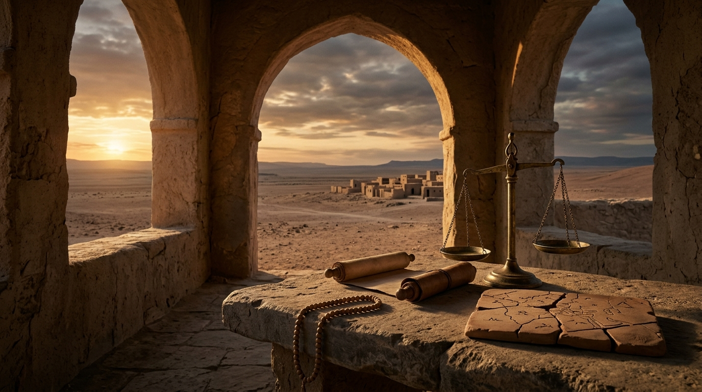

# Али: хороший сподвижник, праведный мусульманин, но слабый политик

*Различие между личной добродетелью и политической компетентностью — и то, как позднейшая религиозная традиция превратила политические неудачи в признаки скрытой мудрости.*

---

Али ибн Абу Талиб занимает особое место в исламской истории. Он был двоюродным братом и зятем Мухаммада, одним из первых принявших ислам, близким сподвижником и видной фигурой в первой мусульманской общине. Его храбрость, личное благочестие и близость к Пророку стали центральными элементами его исторического и религиозного образа.

Для мусульман-шиитов Али — гораздо больше, чем уважаемый сподвижник. Он — законный преемник Мухаммада, первый имам и непогрешимый наставник, чей авторитет установлен свыше. В этом понимании его политическое поражение не умаляет его положения. Оно становится ещё одним эпизодом в истории несправедливо притеснённого имама.

Но есть вопрос, который религиозное почтение часто мешает задать:

> **Был ли Али на самом деле хорошим политическим лидером?**

Не хорошим человеком. Не храбрым воином. Не искренним верующим. Именно политическим лидером — человеком, способным управлять конкурирующими интересами, выстраивать устойчивую коалицию, поддерживать дисциплину, идти на трудные компромиссы и превращать авторитет в эффективное управление.

Это разные качества.

Человек может быть нравственно безупречным и политически неэффективным. Он может быть храбрым на поле боя и плохо справляться с управлением войском. У него могут быть законные претензии, но при этом он способен принимать разрушительные решения.

Халифат Али даёт достаточно материала, чтобы рассмотреть именно это различие.

---

## 1. Человек, который должен был стать законным преемником

Вопрос о преемственности после смерти Мухаммада стал одним из определяющих конфликтов в исламской истории.

В глазах многих мусульман у Али были веские личные основания претендовать на лидерство. Его родство с Мухаммадом, раннее принятие ислама, участие в период становления общины и положение среди родственников Пророка придавали ему значительный авторитет.

Во время ранних споров о преемственности у него были сторонники. Однако позднейшее шиитское учение об имамате не следует просто проецировать в прошлое так, словно вполне сформированная конфессиональная система уже существовала в том же виде при жизни Мухаммада.

Это различие важно.

Изначально существовал политический вопрос о том, кто должен возглавлять общину. Со временем этот вопрос перерос в конкурирующие богословские объяснения законной власти. В шиитской мысли положение Али стало частью более широкого учения о божественно назначенных и непогрешимых имамах.

Книга Вильферда Маделунга *The Succession to Muhammad* здесь особенно важна. Маделунг серьёзно относится к притязаниям Али и рассматривает политические обстоятельства вокруг преемственности, вместо того чтобы отбрасывать их как позднейшую выдумку. Его работа полезна именно тем, что не требует исходить из предпосылки, будто Али был либо узурпатором, либо непогрешимым правителем.

Но у того, как выстраивается позднейший нарратив, есть проблема.

Сторонники Али помнят о том, что власть не перешла к нему сразу. Они подчёркивают несправедливость более ранней преемственности и изображают его eventual'ный приход к власти как запоздалое признание права, которое всегда должно было принадлежать ему.

Допустим. Но что произошло, когда он наконец стал халифом?

Он унаследовал этот пост в 656 году н. э., после убийства Усмана. И его реальное правление не было демонстрацией политического мастерства. Оно стало периодом гражданской войны, расколотой власти, неподчинения в войске и постепенной утраты контроля над крупными частями халифата.

Можно утверждать, что обстоятельства были исключительно тяжёлыми. Это правда.

Но именно в тяжёлых обстоятельствах и проверяется политическое лидерство.

---

## 2. Приход к власти в тени убийства Усмана

Али стал халифом после того, как Усман был убит мятежниками, осаждавшими его дом в Медине.

Это не была обычная передача власти. Предыдущий правитель был убит, политический порядок пошатнулся, а вооружённые группы, участвовавшие в восстании, всё ещё находились рядом.

Али принял халифат в этих условиях.

Главный вопрос был очевиден с самого начала: что будет с теми, кто несёт ответственность за убийство Усмана?

Позицию Али традиционно объясняют опасностью слишком поспешных действий. Мятежники были вооружены, правительство — неустойчиво, и немедленная попытка арестовать и наказать всех причастных могла спровоцировать новый конфликт.

Это серьёзный довод. Правитель не может просто игнорировать расстановку сил и рассчитывать, что хрупкое государство устоит.

Но политические последствия отсрочки правосудия были не менее серьёзными.

Усман был главой мусульманской общины. Его убийство было не просто преступлением против частного лица. Оно стало ударом по самому политическому институту. Если новый правитель не мог добиться того, чтобы подобное деяние было расследовано и наказано, его легитимность немедленно оказывалась под вопросом.

Поэтому перед Али встала дилемма: выступить против подозреваемых и рискнуть немедленным столкновением либо отложить расследование и рискнуть выглядеть неспособным или не желающим наказать убийц.

Он выбрал отсрочку.

Проблема состояла в том, что ему не удалось успешно превратить эту временную отсрочку в убедительное политическое урегулирование. Он не выстроил процесс, который мог бы удовлетворить его противников, укрепить общественное доверие и изолировать виновных в убийстве.

Эта неудача стала главным аргументом, который Аиша, Тальха и аз-Зубайр использовали против его правительства.

Важно не считать, будто каждый человек в войске Али участвовал в убийстве Усмана. Мятежники не представляли собой единое, чётко очерченное воинское подразделение, и имеющиеся источники не позволяют с достоверностью установить каждого участника. Но присутствие людей, связанных с восстанием, среди сил, поддерживавших новый режим, создавало очевидную политическую проблему.

Али требовалось правительство, способное расследовать убийство его предшественника. Вместо этого он унаследовал коалицию, интересы участников которой были далеко не тождественны.

Это стало первым крупным испытанием его политического суждения.

---

## 3. Смещение наместников: принципы без политического расчёта времени

Али также предпринял шаги по замене наместников, назначенных при Усмане.

Для этого были понятные причины. Администрация Усмана подвергалась резкой критике за назначения с участием членов его семьи и за сосредоточение влияния у отдельных элит. Али хотел задать иное политическое направление.

Но новый правитель не действует в вакууме.

Провинциальные наместники были не просто чиновниками за столом. Они контролировали региональную администрацию, налогообложение, военные ресурсы и связи с влиятельными племенными и местными лидерами.

Немедленное смещение означало столкновение с людьми и сетями влияния, на которые новое правительство могло бы в иных условиях опереться.

Наиболее важным случаем был Муавия в Сирии.

Муавия управлял провинцией годами. За это время он выстроил отношения с племенным руководством, заручился лояльностью войска и создал действующую региональную базу власти. Он был не просто очередным чиновником, которого можно заменить приказом из Медины.

Согласно сообщениям, советники предостерегали Али от немедленного смещения Муавии. Точные слова и детали бесед в исторических источниках различаются, поэтому их не следует воспринимать как стенограмму заседания совета. Но лежащая в основе политическая проблема ясна: решение Али немедленно заменить сирийского наместника превратило и без того сложный кризис преемственности в прямое противостояние с могущественным региональным правителем.

Временный компромисс мог бы сохранить пространство для переговоров.

Вместо этого Али выбрал быструю кадровую замену, не обеспечив предварительно политические условия, необходимые для её проведения в жизнь.

Есть разница между правом назначать должностных лиц и силой, позволяющей сделать эти назначения действенными.

Первым Али обладал. Со вторым у него возникали трудности.

---

## 4. Политика Усмана и разница между справедливостью и управлением

Правление Усмана породило серьёзное недовольство. Его назначения и распределение ресурсов входили в число причин оппозиции, которая в итоге переросла в насилие.

Но исправление политики предшественника требует большего, чем признание её ошибочности.

Новый правитель должен учитывать, кто потеряет власть, кто окажет сопротивление, какими ресурсами располагает правительство и сможет ли государство пережить переходный период.

Политический курс Али часто представлялся как попытка восстановить справедливость и вернуть общину к более принципиальной форме правления. Однако политика может быть нравственно привлекательной и политически разрушительной, если проводится без реалистичного понимания вовлечённых сил.

Это не довод в пользу того, что Али следовало бесконечно покрывать коррупцию. И не утверждение, что администрация Усмана была выше критики.

Это довод о политической компетентности.

Успешный правитель должен знать не только то, что должно измениться, но и как, когда и какой ценой.

Противники Али понимали политическую ценность терпения, союзов и региональной власти. Его правительству с трудом удавалось перевести свои нравственные притязания в устойчивое политическое устройство.

---

## 5. Верблюжья битва: политический кризис, переросший в гражданскую войну

Аиша, Тальха и аз-Зубайр стали наиболее видными фигурами в оппозиции правительству Али.

Их заявленное требование было связано с убийством Усмана и необходимостью наказать виновных. Их движение также бросало вызов политическому урегулированию, благодаря которому Али стал халифом.

Они отправились в Басру — важный иракский город со значительным экономическим и стратегическим значением.

События там носили насильственный характер. Оппозиция взяла город под контроль, сместила наместника Али, и между противоборствующими группами произошли столкновения. Исторические сообщения говорят о казнях людей, обвинённых в причастности к убийству Усмана, хотя числа и детали различаются.

Действия оппозиции не становились автоматически оправданными лишь потому, что она требовала справедливости за Усмана. Захват крупного города и применение вооружённой силы для навязывания политических требований сами по себе были опасной эскалацией.

Но политический вопрос остаётся: почему Али не сумел выстроить процесс, способный решить проблему до того, как оппозиция перешла к силовому давлению?

Он мог добиваться переговорного урегулирования, искать более широкие консультации или попытаться отделить тех, кто искренне требовал расследования, от тех, кто стремился к более широкому политическому противостоянию.

Вместо этого кризис обострился.

Али собрал войско и выступил к Басре. Противоборствующие силы в итоге сошлись в Верблюжьей битве в декабре 656 года.

Некоторые более поздние сообщения описывают переговоры перед битвой и утверждают, что соглашение было близко. Другие версии приписывают начало боя ночному нападению людей, которые опасались, что урегулирование выдаст их на расправу за участие в убийстве Усмана.

Эта версия важна, но к ней следует относиться как к спорной исторической реконструкции, а не как к установленному факту. Источники не позволяют с достоверностью определить, кто начал бой, или доказать, что какая-то конкретная группировка намеренно сорвала уже готовое соглашение.

Что можно утверждать с уверенностью, так это то, что правительство Али не смогло предотвратить перерастание политического конфликта в крупную гражданскую войну.

После битвы силы Али одержали верх. Тальха и аз-Зубайр были убиты. С Аишей обошлись уважительно и отправили её обратно в Медину.

Решение Али остановить кровопролитие после поражения оппозиции было разумным. Продолжение расправ принесло бы мало пользы.

Но завершить битву — не то же самое, что разрешить породивший её политический кризис.

---

## 6. Войско, которое не хотело подчиняться своему командующему

Это один из самых показательных аспектов правления Али — и он особенно интересен тем, что свидетельства исходят из речей, приписываемых самому Али.

В 27-й проповеди *Нахдж аль-Балага* Али выражает глубокое раздражение жителями Ирака за их нежелание откликаться на военные приказы.

Он жалуется, что, когда велит им выступить в поход летом, они просят подождать, пока спадёт жара. Когда велит выступить зимой, они сетуют на холод и просят подождать, пока улучшится погода.

Затем следует одно из самых известных оскорблений, приписываемых ему:

> «О вы, подобие мужчин, а не мужчины! Ум у вас — как у детей…»

Далее он говорит, что их неповиновение и оставление его без поддержки настолько подорвали его решения, что курайшиты стали говорить, будто Али храбр, но не знает военного дела.

Самая показательная фраза звучит в конце:

> «Но нет мнения у того, кому не повинуются».

Это поразительное признание.

Али не просто жалуется на лень своих воинов. Он описывает коренной сбой командования. Он может выработать стратегию, отдать приказы и призвать к военным действиям, но не может надёжно заставить собственные силы исполнить эти решения.

Другая речь — 39-я проповедь — выражает то же раздражение. Али жалуется, что приказывает людям, которые не повинуются, призывает тех, кто не откликается, и не может добиться своих целей, поскольку собственные сторонники его не поддерживают.

С этими текстами следует обращаться осторожно. *Нахдж аль-Балага* был составлен аш-Шарифом ар-Ради на рубеже X и XI веков, спустя несколько столетий после смерти Али. Это не военный протокол эпохи, и не все входящие в него проповеди имеют независимо проверяемые цепочки передачи. Поэтому их следует описывать как речи, приписываемые Али, а не воспринимать как автоматически удостоверенные исторические записи.

Тем не менее они представляют собой важное свидетельство об образе Али, сохранённом в самой традиции: правителя, глубоко уязвлённого неподчинением и ненадёжностью своих иракских сторонников.

И это подводит нас к базовому принципу политического лидерства.

Если находящиеся под твоим командованием люди регулярно игнорируют приказы, проблема не только в их нелояльности. Она также в твоей неспособности установить действенное командование.

Военачальник не может просто проводить время, оскорбляя своих воинов, а затем заявлять, что вся вина лежит исключительно на них.

Разумеется, у воинов есть свои обязанности. Отказ защищать общину или бегство из войска могут быть проявлением малодушия. Но правитель несёт ответственность за создание организации, в которой люди понимают свои обязательства, доверяют руководству и имеют достаточные стимулы исполнять приказы.

Собственные жалобы Али показывают, насколько плохо это работало.

Его войско не было единым политическим инструментом. Это была коалиция разных групп с разными интересами, лояльностью и степенью вовлечённости. Многие поддерживали Али в принципе, но не хотели нести издержки его военной политики.

Командующий, который не может надёжно мобилизовать собственные силы, сталкивается с серьёзной политической проблемой.

И сам Али, похоже, понимал это, когда сетовал, что никто не может проводить в жизнь взвешенное решение, если ему никто не повинуется.

---

## 7. Муавия: противник, который понимал, как управлять властью

Сравнение с Муавией неизбежно.

Муавия был не просто соперником, в распоряжении которого случайно оказалось войско. Он управлял Сирией задолго до того, как Али стал халифом. За это время он выстроил отношения с племенными лидерами, создал региональную политическую сеть и сохранил лояльность военной базы, которая стала опорой его выступления против Али.

Его успех зависел не только от тактики на поле боя, но и от политического управления.

Эндрю Маршам в книге *Rituals of Islamic Monarchy* подчёркивает значение сплочённости и лояльности сирийского войска Муавии во время гражданской войны. Политические позиции Муавии усиливались давними региональными связями и умением сохранять поддержку сирийской военной и племенной знати.

*The New Cambridge History of Islam* также рассматривает роль племенных вождей, местных элит, покровительства и политических связей в становлении власти Омейядов.

Это принципиально важно.

Муавия понимал, что войско удерживается не одними лозунгами. Нужны отношения, стимулы, признанное руководство и политическая структура, при которой у военачальников и племенной знати есть причины оставаться верными.

Он умел работать с людьми, которые фактически распоряжались военными ресурсами.

Али же, напротив, неоднократно с трудом сохранял сплочённость собственной коалиции.

Это не означает, что Муавия был нравственно выше. Его политические методы включали расчётливые союзы, покровительство, принуждение и манипуляции. Он не был образцом религиозной добродетели лишь потому, что эффективнее управлял властью.

Но политическое сравнение очевидно.

Муавия лучше умел превращать политические связи в военную лояльность. Али был более известен личной храбростью и нравственным авторитетом, но ему с трудом удавалось превратить эти качества в эффективное управление.

При Сиффине в 657 году это различие стало особенно заметным.

Силы Али не обязательно уступали противнику в военном отношении. Напротив, сражение, судя по всему, поставило сторону Муавии в тяжёлое положение. Но Муавия и его советники использовали расколы внутри коалиции Али.

Знаменитый призыв к третейскому разбирательству, когда на копьях подняли свитки Корана, стал переломным моментом. Точные детали и мотивы в позднейших нарративах обсуждаются, но политический эффект был ясен: коалиция Али раскололась ещё сильнее, и он не смог удержать единую позицию.

Исследование Майкла Хайндса о событиях при Сиффине здесь особенно полезно. Он разбирает, как Муавия и Амр ибн аль-Ас использовали противоречия внутри коалиции Али и как различные политические интересы сторонников Али повлияли на исход.

Результатом стал не просто военный тупик. Это было политическое поражение Али.

Муавия сохранил свою сирийскую базу в целости. Власть Али продолжала слабеть.

---

## 8. Сиффин и распад коалиции Али

Сиффин обнажил ту же слабость, которая проявилась уже во время Верблюжьей битвы: Али не мог надёжно контролировать политические силы, собравшиеся под его знаменем.

Кризис вокруг арбитража ещё сильнее усугубил положение.

Некоторые из собственных сторонников Али давили на него, требуя принять арбитраж. Позже часть тех же людей выступила против него, обвинив в принятии человеческого суда там, где, по их убеждению, должно было действовать лишь решение Аллаха.

Они стали известны как хариджиты.

Теперь Али столкнулся с противодействием не только со стороны Муавии, но и со стороны движения, возникшего в его собственном лагере.

Он сразился с хариджитами при Нахраване в 658 году. Хотя битва стала военной победой, она не решила более глубокой проблемы. Политические расколы внутри Ирака сохранялись, а способность Али мобилизовывать поддержку снижалась.

Эту закономерность трудно не заметить:

* Его правительство не смогло разрешить кризис вокруг убийства Усмана.
* Попытка сменить наместников способствовала сопротивлению влиятельных региональных элит.
* Его коалиция вступила в Верблюжью битву.
* Его войско раскололось во время конфликта с Муавией.
* Согласие на арбитраж способствовало дальнейшему внутреннему расколу.
* Бывшие сторонники в итоге стали вооружёнными противниками.

Каждое событие можно объяснять по отдельности. Но в совокупности они выявляют устойчивую политическую слабость.

Али не сумел выстроить стабильную коалицию, способную выдержать давление гражданской войны.

---

## 9. «Он всё знал наперёд»: проблема ретроспективной непогрешимости

Здесь историческое обсуждение приобретает особое значение для шиитского богословия.

В позднейшей шиитской мысли Али — не просто праведный сподвижник или законный политический лидер. Он — непогрешимый имам, обладающий особым, дарованным свыше авторитетом.

Это создаёт проблему при рассмотрении его политических неудач.

Если Али принял неудачное решение, объяснение может сводиться к тому, что он знал последствия, но действовал согласно высшему божественному плану.

Если сторонники оставили его, это можно объяснить тем, что он заранее знал, что так произойдёт.

Если он утратил политический контроль, эту утрату можно представить как ниспосланное свыше испытание.

Если он не сумел предотвратить кровопролитие, эту неудачу можно истолковать как часть предопределённого хода событий.

Но что это за утверждение?

Теорию, которая истолковывает любой возможный исход как свидетельство мудрости, нельзя осмысленно проверить.

Если успех доказывает, что имам был мудр, и неудача тоже доказывает, что он был мудр, то никакой политический результат никогда не сможет опровергнуть это утверждение.

Это не исторический анализ. Это система ретроспективного оправдания.

И она порождает ещё более фундаментальную путаницу: праведность не делает человека политически непогрешимым.

Человек может быть искренним и при этом неверно понять политическую ситуацию. Может быть храбрым и при этом принять неудачное стратегическое решение. Может иметь прекрасные намерения и всё же выбрать образ действий, ведущий к разрушительным последствиям.

В утверждении, что Али был праведным мусульманином и слабым политическим лидером, нет противоречия.

Противоречие возникает лишь тогда, когда позднейшее богословие настаивает, будто его религиозный статус должен автоматически гарантировать правильность каждого политического решения.

---

## 10. Сравнение с Мухаммадом: пророческое лидерство не передавалось автоматически

Одно из наиболее показательных сравнений — сравнение с самим Мухаммадом.

При жизни Мухаммад шёл на политические компромиссы, которые в краткосрочной перспективе могли выглядеть унизительными или невыгодными.

Известный пример — Худайбийский договор. Соглашение включало уступки, которые некоторым его сподвижникам было трудно принять. Однако Мухаммад понимал стратегическую ценность временного компромисса и долгосрочные возможности, которые он мог открыть.

Это был политический расчёт.

Лидеру порой приходится принимать договорённость, не удовлетворяющую каждое сиюминутное требование, чтобы сохранить более крупную цель.

Али сталкивался с ситуациями, в которых подобная политическая гибкость могла быть полезной. Вопрос не в том, должен ли он был копировать каждое решение Мухаммада. Вопрос в том, проявил ли он ту же способность просчитывать политические последствия, управлять конкурирующими интересами и сохранять единство.

Нет оснований полагать, что он автоматически обладал всеми способностями Пророка лишь потому, что был близок к нему.

Мухаммад был пророком. Его авторитет был связан с его пророческой миссией. Али пророком не был.

Коран не представляет Али как второго Мухаммада и не обещает, что он унаследует пророческие способности в государственном управлении, дипломатии или знании будущего.

Позднейшее религиозное почтение не должно стирать это различие.

Человек может входить в число самых уважаемых людей раннего поколения, не становясь при этом безупречным политическим стратегом.

---

## 11. История с клеветой против Аиши: человеческая реакция в историческом свидетельстве

Есть ещё один эпизод, который стоит рассмотреть, хотя он относится скорее к вопросу о более позднем образе Али, чем к его политическому управлению.

В традиционном рассказе о *хадисе аль-ифк* — эпизоде с обвинениями против Аиши — Мухаммад советовался с несколькими людьми. В сообщении, сохранённом в *Сахихе аль-Бухари*, Усама ибн Зайд выступил в защиту Аиши, тогда как Али заметил, что у Мухаммада есть и другие женщины, и предложил расспросить о ней служанку Аиши Бариру.

В этом сообщении не говорится, будто Али приказал избить Бариру. Важно не добавлять эту деталь.

Тем не менее ответ Али был скорее прагматичным, чем немедленным и однозначным заявлением о том, что обвинение ложно.

То, как Коран рассматривает этот эпизод в суре 24, включает прямую критику верующих, которые не отнеслись друг к другу с добрым предположением с самого начала и не отвергли обвинение как явную клевету (24:12).

Это не доказывает, что Али знал о невиновности Аиши и сознательно не стал её защищать. И не доказывает, что он обладал сверхъестественным знанием и предпочёл им не воспользоваться.

Но это показывает, почему исторические сообщения об Али следует рассматривать как свидетельства о человеке, а не перетолковывать автоматически ради сохранения позднейшего богословского образа.

Если каждая человеческая реакция после того, как исход стал известен, превращается в скрытую мудрость, исторические свидетельства утрачивают способность сообщить нам что-либо новое.

---

## 12. Праведный человек не обязательно хороший правитель

Историческая репутация Али опирается на ряд подлинных качеств.

Он был видным ранним мусульманином, близким сподвижником Мухаммада, храбрым воином и фигурой значительного личного авторитета. Его значение в формировании исламской истории бесспорно.

Но ни одно из этих качеств автоматически не делает его успешным правителем.

Его халифат отмечен неспособностью добиться политического урегулирования после убийства Усмана, утратой контроля над крупными региональными структурами власти, повторяющимися расколами внутри собственной коалиции и неспособностью поддерживать надёжное военное подчинение.

Сравнение с Муавией делает этот контраст особенно явным. Муавия был эффективнее в укреплении региональной лояльности, управлении племенными элитами и поддержании сплочённой военной базы. Али неоднократно сталкивался с трудностями в этих задачах.

Это не делает Муавию нравственно выше. Политическая эффективность и нравственная праведность — разные категории.

И это не означает, что за гражданскую войну отвечал один лишь Али. Он унаследовал крайне неустойчивую ситуацию, а его противники принимали собственные решения применять силу, добиваться власти и затягивать конфликт.

Но сложные обстоятельства не снимают с правителя ответственности за принятие действенных решений.

А собственные речи Али, сохранённые в *Нахдж аль-Балага*, дают яркий образ командующего, глубоко уязвлённого теми, кто отказывался ему повиноваться.

Его сетование на то, что «нет мнения у того, кому не повинуются», — пожалуй, самое показательное политическое высказывание, приписываемое ему.

Правитель, который не способен сделать свои решения действенными, не обладает полнотой политической власти, сколь бы законным ни считал своё притязание на неё.

Поэтому самый разумный вывод состоит в том, чтобы не демонизировать Али и не превращать его в неприкасаемую фигуру.

Он мог быть хорошим сподвижником, искренним верующим и храбрым человеком — и при этом оставаться слабым политическим стратегом.

Личная праведность — не политическая компетентность. Близость к пророку — не наследование пророческих способностей. А поражение в политической борьбе не становится автоматически свидетельством божественной мудрости.

Истории следует позволить рассматривать Али так же, как она рассматривает других правителей: через их решения, результаты, успехи и неудачи.

В противном случае мы уже не изучаем историческую личность.

Мы охраняем образ.

---

## Источники и литература

### Ранняя исламская история и кризис преемственности

1. **Madelung, Wilferd.** *The Succession to Muhammad: A Study of the Early Caliphate.* Cambridge University Press, 1997. Крупное исследование споров о преемственности, притязаний Али, убийства Усмана и политических обстоятельств раннего халифата.
2. **al-Tabari.** *The History of al-Tabari, Vol. 16: The Community Divided.* Перевод Эдриана Брокетта. State University of New York Press, 1997. Ранние исторические свидетельства о событиях вокруг убийства Усмана, прихода Али к власти и Верблюжьей битвы.
3. **Kennedy, Hugh.** *The Prophet and the Age of the Caliphates: The Islamic Near East from the Sixth to the Eleventh Century.* Routledge. Обширная политическая история раннего халифата, включая Первую фитну и становление власти Омейядов.

### Али, Муавия и Первая фитна

1. **Hinds, Michael.** “The Siffin Arbitration Agreement.” *Journal of Semitic Studies*, 1972. Исследование кризиса вокруг арбитража и политических разногласий внутри коалиции Али.
2. **Marsham, Andrew.** *Rituals of Islamic Monarchy: Accession and Succession in the First Muslim Empire.* Edinburgh University Press, 2009. Рассматривает политические основания власти Муавии, включая значение лояльности сирийского войска и региональных сетей.
3. **Kennedy, Hugh.** *The Armies of the Caliphs: Military and Society in the Early Islamic State.* Routledge, 2001. Исследование ранней исламской военной организации, комплектования войск, племенных структур и связи между политической властью и военной лояльностью.
4. **Robinson, Chase F. (ed.).** *The New Cambridge History of Islam, Volume 1: The Formation of the Islamic World, Sixth to Eleventh Centuries.* Cambridge University Press, 2010. Обширный академический очерк политических и административных структур раннего исламского государства.

### Первичные тексты, приписываемые Али

1. ***Nahj al-Balagha***, составленный аш-Шарифом ар-Ради (ум. 1015 г. н. э.):
   * *Проповедь 27:* критика иракских сил за нежелание выступать в поход и сражаться; включает выражение «О вы, подобие мужчин, а не мужчины» и утверждение о том, что нет пользы во мнении того, кому не повинуются.
   * *Проповедь 39:* дальнейшая критика людей, отказывающихся выполнять военные приказы.
   * Эти речи приписываются Али в сборнике, составленном спустя столетия после его смерти; их индивидуальную историческую подлинность не следует принимать без дальнейшей проверки.

### Коран

* **24:12** — реакция, ожидаемая от верующих при известии об обвинении против Аиши.
* **17:36** — ответственность за утверждения и действия, не опирающиеся на знание.
* **2:170** — критика бездумного следования унаследованным убеждениям.
* **9:31** — опасность наделения человеческих религиозных авторитетов положением, принадлежащим Аллаху.
