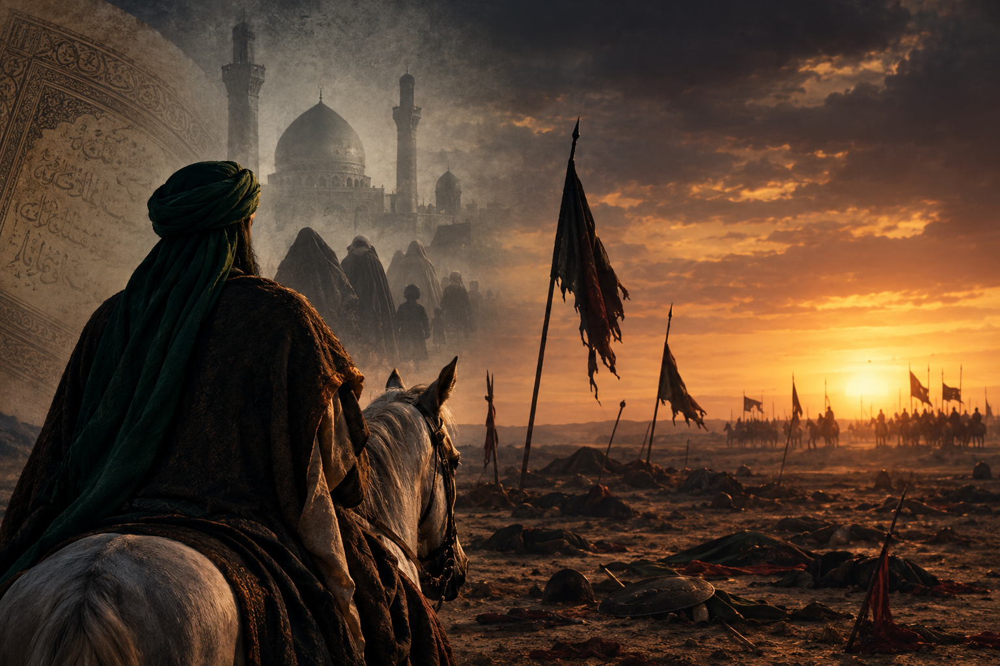

# Хусейн в Кербеле: когда политический просчёт превратился в культ

*Предвидение будущего, провальные политические решения, судьба целой семьи и превращение исторической трагедии в сакральный нарратив.*

---

Кербелу обычно представляют как историю с заранее определённым моральным выводом: Хусейн был праведником, Язид — несправедливым правителем, Хусейн погиб мученической смертью, а его гибель стала вечным символом сопротивления тирании.

Но если на время убрать религиозную рамку и посмотреть на события как на историю, возникает другой вопрос.

Хусейн ибн Али выступил против власти Язида, направился в сторону Куфы, рассчитывая на обещанную поддержку, и в итоге оказался перед лицом омейядских войск после того, как политическая ситуация изменилась не в его пользу. Он погиб вместе со многими мужчинами из своего окружения и родственниками. Женщины и дети из его отряда выжили и попали в плен.

Трагедия реальна. Вопрос в том, какой вывод мы должны из неё сделать.

Был ли это заранее рассчитанный шаг безошибочного имама, который знал, что его ждёт? Или перед нами провальная политическая экспедиция, исход которой позднее получил сакральное значение?

Это не взаимозаменяемые объяснения. И чем более исключительными становятся утверждения о Хусейне, тем труднее согласовать их с реальным ходом событий.

---

## 1. Если Хусейн знал, что погибнет, чего именно он пытался добиться?

В двунадесятническом шиизме вопрос о знании имамов занимает важное место. Некоторые богословы утверждают, что Хусейн знал о своей предстоящей гибели. Другие различают предвидение мученической смерти и знание всех обстоятельств, которые к ней приведут.

Это различие имеет значение. Не стоит делать вид, будто все шиитские богословы придерживаются совершенно одинаковой позиции.

Но рассмотрим последствия более сильного утверждения: Хусейн заранее знал, что погибнет в Кербеле, что его спутников перебьют, а сопровождавшие его женщины и дети окажутся в плену.

Что именно делает такое решение примером безошибочного политического руководства?

Если Хусейн не знал реального соотношения сил, его поездку можно рассматривать как человеческое политическое решение. Он получал информацию, оценивал ситуацию, принимал решения и сталкивался с последствиями. Он мог переоценить собственную поддержку, недооценить противников или ошибиться в оценке того, насколько быстро ситуация в Куфе выйдет из-под контроля.

Это превращает Кербелу в человеческую трагедию. Но не делает Хусейна ничтожным человеком и не лишает его гибель всякого смысла. Это означает лишь, что его решения можно критиковать.

Теперь рассмотрим другой вариант: он знал, что экспедиция закончится его гибелью и уничтожением его отряда.

Одно дело — сознательно рисковать собственной жизнью. Другое — сознательно подвергать той же участи других людей.

Если исход был известен заранее, зачем продолжать путь? Чего можно было добиться, двигаясь навстречу столкновению, из которого он заведомо не мог выйти живым? Почему был необходим именно этот путь? И почему сознательное принятие такого исхода автоматически объявляется мудростью?

Назвать происходящее божественной миссией — не значит ответить на эти вопросы. Это лишь придаёт решению сакральный статус.

Здесь важно различать две вещи: предвидение и безошибочность. Само по себе знание о том, что событие произойдёт, ещё не доказывает, что каждое решение, приведшее к нему, было морально оправданным. Даже если Хусейн предвидел собственную смерть, из этого не следует, что все его поступки были правильными.

Однако чем более полным объявляется его предвидение, тем труднее объяснить его решения как действия безошибочного руководителя.

---

## 2. Что Коран действительно устанавливает относительно Хусейна?

Коран прямо не называет Хусейна безошибочным имамом. Он не объявляет его по имени божественно назначенным политическим руководителем и не утверждает, что потомки Мухаммада обладают всеобъемлющим знанием сокровенного.

В Коране 33:33 говорится об очищении Людей Дома. Но утверждение об очищении не означает автоматически всеобщую безошибочность, гарантированное право на политическую власть или знание будущих событий.

Это дополнительные богословские выводы. Для них нужны дополнительные аргументы.

То же относится к знанию сокровенного.

В Коране 27:65 говорится, что никто на небесах и на земле не знает сокровенного, кроме Аллаха. В 72:26–27 сказано, что Аллах открывает сокровенное избранному Им посланнику.

Даже если признать, что Аллах может сообщать посланнику отдельные сведения о сокровенном, потребуется дополнительное обоснование того, что Хусейн получил знание о конкретных обстоятельствах Кербелы, что это знание охватывало все существенные последствия и что подобное знание являлось определяющим свойством каждого имама.

Нельзя просто предположить нужный вывод в начале рассуждения, а затем использовать его для объяснения любого события.

Иначе получается замкнутая логика: Хусейн был безошибочным, потому что был имамом, а его решения были правильными, потому что их принимал безошибочный имам.

Это не независимое доказательство. Это убеждение, защищающее само себя от проверки.

Принадлежность к семье Пророка тоже не означает автоматически, что человек обладает особым статусом, освобождающим его от обычной моральной и политической оценки. Если такое исключение существует, где именно Коран его устанавливает?

---

## 3. Предупреждения, которые получал Хусейн

В исторических источниках сохранились сообщения о том, что Хусейна отговаривали от поездки в Ирак. Среди тех, кому приписывают подобные предупреждения, — Ибн Аббас, Абдуллах ибн Умар, Мухаммад ибн аль-Ханафийя и Абдуллах ибн аз-Зубайр.

Точные формулировки и подробности отдельных разговоров следует оценивать осторожно. Эти сообщения дошли до нас через историческую традицию, и не каждую описанную беседу можно независимо подтвердить.

Тем не менее общая проблема остаётся: решение Хусейна вызывало возражения, а опасность зависимости от политической поддержки Куфы не была совершенно непредсказуемой.

Затем ситуация ухудшилась.

Муслим ибн Акиль, которого Хусейн отправил для оценки и организации поддержки в Куфе, был схвачен и казнён после того, как власти восстановили контроль над городом. Хусейн узнал о крахе своей поддержки уже в пути, направляясь в Ирак.

К этому моменту политический расчёт существенно изменился.

Вопрос не в том, должен ли был Хусейн обладать сверхъестественным знанием. Вопрос в том, должен ли политический руководитель пересматривать свою стратегию, когда информация, на которой она основывалась, оказывается ненадёжной.

Именно в изменившихся обстоятельствах и проверяется политическое чутьё.

Продолжать движение навстречу сильному противнику после краха первоначального плана — решение, требующее серьёзного обоснования. Одной надежды на то, что ситуация каким-то образом изменится, недостаточно.

Однако необходимо различать критику решения и уверенные заявления о мотивах. Исторические свидетельства не позволяют доказать, что Хусейн руководствовался исключительно личными амбициями. Его политические цели, противостояние Язиду и представление о собственных обязанностях требуют отдельного рассмотрения.

Но мы можем оценивать стратегию, доступную информацию, риски и последствия.

То, что Хусейн в итоге погиб, не доказывает, что продолжать путь было самым разумным из доступных решений. А то, что позднейшие поколения придали его гибели сакральное значение, не делает задним числом его прежние решения более обоснованными.

---

## 4. Зачем брать с собой семью?

Это один из самых неудобных вопросов во всей истории.

Хусейн отправился в путь не один. Его сопровождали женщины и дети из семьи. Исторические повествования описывают пленение выживших членов семьи после сражения.

Их присутствие не доказывает, что Хусейн ожидал поражения. Оно также не доказывает, что он намеренно использовал родственников как политический инструмент. Это более сильные утверждения, чем позволяют сделать имеющиеся свидетельства.

Но присутствие семьи делает вопрос ответственности неизбежным.

Если Хусейн считал, что у экспедиции есть реальные шансы на успех, его решение взять с собой семью могло казаться ему оправданным. Если же он с уверенностью знал, что его ждут поражение, смерть и пленение близких, объяснить такое решение гораздо труднее.

В Коране 6:164 говорится, что никто не понесёт бремя другого. Этот аят касается индивидуальной ответственности перед Аллахом и не является прямым историческим постановлением о походе Хусейна. Тем не менее он подчёркивает важное различие: собственная религиозная или политическая цель не отменяет самостоятельных интересов других людей.

Убеждённость руководителя не делает любой риск, которому он подвергает окружающих, морально приемлемым.

И если страдания семьи Хусейна были якобы необходимой частью божественного плана, где в Коране установлено именно такое требование?

Кто санкционировал эту жертву? Какие текстуальные основания доказывают, что их пленение было необходимо? Почему позднейшее богословское объяснение следует принимать как доказательство правильности решения?

Эти вопросы заслуживают ответов, а не обвинений в неуважении.

---

## 5. Хасан и Хусейн: два имама, две политические стратегии

Сравнение с братом Хусейна, Хасаном, делает проблему ещё интереснее.

После смерти Али Хасан принял халифат, но впоследствии отказался от политической власти в пользу Муавии в результате соглашения 661 года. Подробности и условия соглашения остаются предметом споров в исторических источниках, но общий ход событий ясен: Хасан принял политический компромисс вместо продолжения военного противостояния, грозившего дальнейшим кровопролитием.

Это было политическое решение, принятое в сложных обстоятельствах. Оно не устранило несправедливость и не гарантировало, что другая сторона выполнит все обязательства.

Тем не менее поступок Хасана показывает нечто важное: отказ от продолжения военного противостояния может быть оправданным решением даже тогда, когда противостоящий правитель считается нелегитимным.

Хасану не требовалось погибать в бою, чтобы доказать верность своим принципам.

Позднее Хусейн избрал другой путь. Он выступил против власти Язида и направился в Ирак, где политическая ситуация в конечном счёте привела к катастрофе.

Обстоятельства двух братьев не были идентичными. Хасан столкнулся с Муавией в иной политической и военной ситуации, тогда как Хусейн противостоял власти Язида после кризиса престолонаследия 680 года. Нельзя оценивать их решения так, будто они принимались в одинаковых условиях.

Но богословский вопрос остаётся.

Если оба брата получали божественное руководство и были неспособны ошибаться, какой принцип объясняет их разные подходы к политической власти?

Если соглашение Хасана было более мудрым способом защитить людей и избежать дальнейшего кровопролития, зачем потребовалось противостояние Хусейна? Если же противостояние Хусейна было предписанным Аллахом путём, означает ли это, что политический компромисс Хасана был менее созвучен воле Аллаха?

Богословская система может ответить, что у разных имамов в разных обстоятельствах были разные обязанности. Но само это объяснение тоже требует доказательств. Нельзя обосновать его одним лишь утверждением, что каждый имам делал именно то, что было необходимо.

Иначе противоположные решения можно объявлять безошибочными задним числом, а само учение становится невозможным для проверки.

Когда Хасан шёл на компромисс, это можно назвать божественной мудростью. Когда Хусейн вступил в противостояние, это тоже можно назвать божественной мудростью. Теория объясняет оба результата, но какой независимый критерий позволяет определить, что каждое решение действительно было правильным?

Если ответ сводится к тому, что имамы безошибочны, то безошибочность не доказана. Она просто принята за исходную посылку.

Это сравнение не доказывает, что Хасан был прав, а Хусейн ошибался. Оно показывает, насколько серьёзное доказательство требуется от тех, кто утверждает, что оба решения гарантированно были правильными благодаря божественному руководству.

---

## 6. Моральная правота не побеждает армию

Есть ещё один неприятный политический урок.

То, что Хусейн был внуком Пророка, не давало ему практического контроля над армией, провинциальной администрацией, дорогами или политической машиной Омейядского государства.

Моральная легитимность и силовые ресурсы — разные вещи.

Человек может иметь веские основания отвергать правителя, не располагая ресурсами для его свержения. Правитель может быть несправедливым, но при этом обладать достаточной силой, чтобы удерживать власть. А притязание на более высокий религиозный статус не гарантирует, что политические противники добровольно откажутся от своих позиций.

Это не оправдание Язида. Это элементарное наблюдение о том, как устроена политическая власть.

Если Хусейн рассчитывал на существенную поддержку жителей Куфы, значение имела надёжность этой поддержки. Если он ожидал переговоров с противостоящими властями, следовало учитывать их интересы и предыдущее поведение. Если он рассчитывал, что происхождение защитит его, имело значение и то, насколько омейядское правительство готово было пренебречь этим обстоятельством.

Политическую стратегию нельзя заменить моральной уверенностью.

При этом исторические свидетельства усложняют привычное утверждение, будто Хусейн просто отказался от любой возможности компромисса. В рассказе, переданном ат-Табари, Хусейну приписывается предложение нескольких вариантов, включая возвращение туда, откуда он пришёл, или отправление к пограничным территориям. Точные детали предложений и их историческая достоверность требуют осторожности, но этот рассказ не подтверждает упрощённую версию, согласно которой Хусейн отверг все возможные выходы.

Решающий вопрос заключался не только в том, был ли Хусейн готов к компромиссу. Важно и то, на какие условия были готовы согласиться его противники.

Это различие имеет значение. Серьёзная историческая критика не должна приписывать все причины трагедии одному лишь упрямству Хусейна, игнорируя решения его противников.

Тем не менее общий политический урок остаётся: ожидать, что противник откажется от власти из-за твоего происхождения, морального авторитета или религиозной легитимности, — не стратегия. Если руководитель недооценивает готовность противника применить силу, последствия могут оказаться катастрофическими.

---

## 7. От исторической трагедии к сакральному повествованию

События Кербелы заняли центральное место в религиозной памяти шиитов. Гибель Хусейна стала символом сопротивления тирании, верности семье Пророка и готовности страдать, но не принимать унижение.

В самом по себе сохранении памяти о жертвах политического насилия или признании морального значения их гибели нет ничего иррационального.

Проблема начинается тогда, когда память превращается в иммунитет от критики.

Политическое решение становится божественным предписанием. Провальная стратегия превращается в доказательство сверхъестественной мудрости. Страдания семьи становятся доказательством того, что эти страдания непременно должны были произойти. Любой вопрос о решениях руководителя воспринимается как нападение на святыню.

Так меняется сама природа исторического исследования.

Вместо вопросов о том, что знал Хусейн, какой информацией располагал, какие альтернативы имел и почему экспедиция продолжилась после краха поддержки в Куфе, верующим предлагают исходить из готового вывода: каждое решение непременно было правильным.

В результате возникает повествование, способное объяснить любой исход, не допуская возможности собственной ошибки.

Если бы Хусейн выжил и установил свою власть, это можно было бы представить как доказательство божественного руководства. Поскольку он погиб, доказательством того же руководства объявляется его гибель. Теория одинаково хорошо объясняет успех и поражение.

Но теория, которая считает любое возможное событие своим подтверждением, не является надёжным способом установить, что произошло в действительности и насколько разумным было принятое решение.

Чтобы усомниться в позднейших богословских объяснениях, не требуется отрицать или преуменьшать историческую трагедию. Страдания были реальными независимо от убедительности последующих религиозных интерпретаций.

---

## 8. Кому выгодно, когда критика становится святотатством?

Позднейшее религиозное значение Кербелы тоже следует изучать исторически.

Памятные обряды могут сохранять коллективную память, выражать скорбь и поддерживать общую идентичность. Религиозные институты также могут укреплять свой авторитет благодаря контролю над интерпретацией священных страданий.

Эти функции способны сосуществовать.

Важный вопрос заключается в том, поощряют ли людей самостоятельно исследовать исторические события или учат, что принятая интерпретация должна оставаться вне критики.

Когда религиозные авторитеты представляют себя хранителями повествования, которое нельзя ставить под сомнение, они получают влияние на то, как верующие понимают верность, справедливость, власть и религиозную идентичность.

Это не доказывает, что каждый священнослужитель намеренно эксплуатирует Кербелу ради денег или власти. Подобное утверждение потребовало бы свидетельств о конкретных институтах и их деятельности.

Более сильная критика носит структурный характер: если институт получает авторитет благодаря сакральному повествованию, у него появляется стимул сохранять авторитет этого повествования. Используют ли отдельные люди этот стимул в корыстных целях — отдельный вопрос.

Кровопролитие в Кербеле было историческим событием. Последующая интерпретация этих событий — тоже исторический процесс. Ни то ни другое не должно быть освобождено от исследования.

---

## Заключение. Почтение не заменяет мышление

Хусейна можно помнить как жертву омейядского насилия, не считая каждое его политическое решение заведомо правильным.

Его гибель может иметь моральное значение, не доказывая, что он обладал всеобъемлющим знанием сокровенного. Его семья заслуживает сочувствия, но её страдания не должны автоматически превращаться в доказательство заранее написанного божественного сценария.

Коран прямо не устанавливает безошибочность Хусейна и не содержит ясного предписания, требовавшего именно того курса действий, который привёл к Кербеле. Эти выводы относятся к более поздним богословским интерпретациям и должны оцениваться самостоятельно.

Исторические вопросы остаются.

Почему Хусейн продолжил путь в Куфу? Как он оценивал полученные предупреждения? Что изменилось после гибели Муслима ибн Акиля? Какие альтернативы ещё оставались? И как следует оценивать риски, которым он подверг сопровождавших его людей?

Эти вопросы не оскорбляют погибших. Они позволяют серьёзно относиться к человеческим последствиям политических решений.

Главная проблема не в том, что Хусейн погиб. Она в том, что позднейшие верующие могут настолько привязаться к сакральному смыслу его гибели, что перестают позволять себе исследовать решения, которые ей предшествовали.

Пророческая миссия завершилась. История продолжилась.

И история не становится откровением только потому, что её участники принадлежали к семье Пророка.

---

## Источники

* **The History of al-Tabari**, Volume XIX: *The Caliphate of Yazid ibn Mu'awiyah*.
* **Madelung, Wilferd.** *Hasan ibn Ali* — *Encyclopaedia Iranica*.
* **Madelung, Wilferd.** *The Succession to Muhammad: A Study of the Early Caliphate*.
* **Encyclopaedia Iranica.** *HOSAYN B. ALI*.
* **Коран:** 6:164; 27:65; 33:33; 72:26–27.
