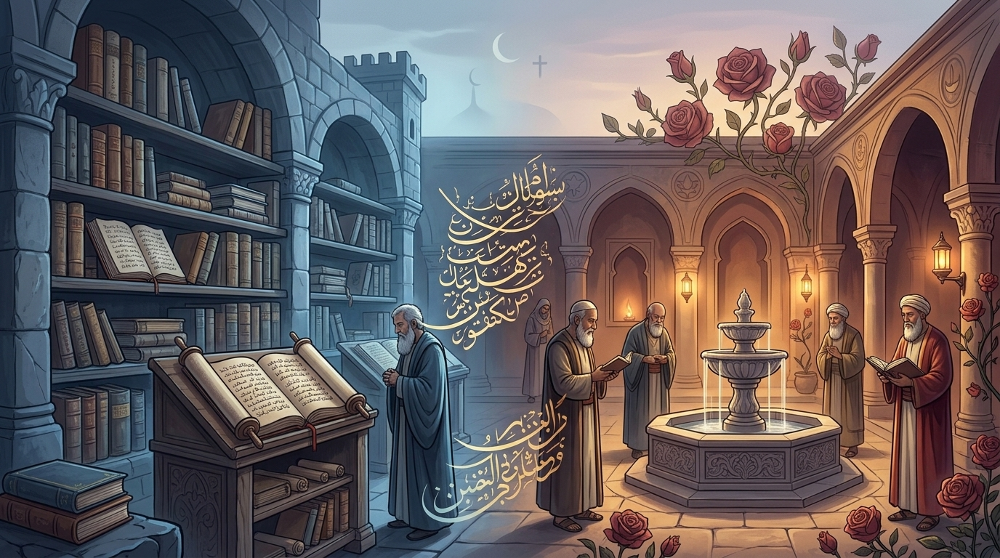

# Как родился Махди: от политического лозунга до бессмертного имама

*Пророческая миссия завершилась. История продолжилась.*

---

## 1. Персонаж, которого нет в Коране

Махди — одна из самых известных фигур исламской эсхатологии. Для одних это будущий праведный правитель, который восстановит справедливость перед концом света. Для других — конкретный имам, который уже родился много веков назад, находится в сокрытии и однажды вернётся.

Суннитские и шиитские представления о Махди существенно различаются. Но у них есть одна общая проблема: Коран не описывает Махди ни как будущего спасителя, ни как скрытого имама, который должен вернуться в конце времён.

Само арабское слово *mahdī* означает «ведомый правильным путём» или «направленный». Оно образовано от корня *h-d-y*, связанного с руководством и наставлением. Этот корень встречается в Коране многократно, но существительное *al-Mahdī* как обозначение эсхатологического спасителя в Коране отсутствует.

Это важное различие. Существование в арабском языке слова со значением «ведомый правильным путём» не доказывает существования конкретного будущего персонажа, которому приписываются особая миссия, сверхъестественное долголетие и способность преобразить мир.

Чтобы понять, как возник этот образ, необходимо выйти за пределы позднейшего вероучения и обратиться к истории.

---

## 2. Политика начинает говорить языком спасения

Раннее развитие махдистских представлений связано с политическими конфликтами после смерти Мухаммада.

После убийства халифа Усмана, гибели Али и последующих конфликтов мусульманский мир оказался разделён борьбой за власть и легитимность. Претензии различных групп на руководство общиной сопровождались ожиданиями восстановления справедливости и возвращения утраченного порядка.

Особенно важным оказался период Второй фитны — гражданских войн 680–692 годов.

В 680-х годах Мухтар ас-Сакафи поднял восстание в Куфе, выступая от имени Мухаммада ибн аль-Ханафии, сына Али ибн Абу Талиба. Ибн аль-Ханафия не был сыном Фатимы, дочери Мухаммада, но его происхождение по линии Али делало его значимой фигурой в борьбе за политическое и религиозное лидерство.

В этой среде возникли ранние представления, связывавшие его с Махди — фигурой, которая должна была восстановить справедливость и исправить совершённые против семьи Мухаммада несправедливости.

Исследователи часто связывают превращение слова *mahdi* в обозначение эсхатологического спасителя с этим периодом. Однако исторические источники не позволяют уверенно утверждать, что именно Мухтар единолично придумал весь образ Махди или что его первоначальные сторонники уже придерживались всех позднейших представлений.

Важнее другое: махдистские идеи развивались в конкретной политической среде, где религиозное ожидание справедливого правителя было связано с борьбой за власть и легитимность.

Это не доказывает, что каждый участник движения сознательно обманывал последователей. Но это позволяет исследовать происхождение идеи исторически, а не принимать её позднейшее религиозное оформление за изначальную истину.

---

## 3. Первая модель сокрытия: лидер, который якобы не умер

Мухаммад ибн аль-Ханафия умер, согласно распространённой датировке, около 700 года. Для его последователей, воспринимавших его как Махди, это создавало серьёзную проблему.

Если он был обещанным спасителем, почему он умер, не выполнив своей миссии?

Часть сторонников, связанных с течением кайсанитов, отказалась признать его окончательную смерть. Согласно известному преданию об их верованиях, Ибн аль-Ханафия не умер, а пребывает в сокрытии на горе Радва и однажды вернётся.

Так сформировалась первая модель махдистского сокрытия: лидер считается живым, несмотря на сообщения о его смерти, а его отсутствие объясняется тем, что он скрыт от людей.

Эта конструкция позволяла сохранить прежние ожидания даже после смерти человека, с которым они были связаны. Его возвращение переносилось в будущее, а отсутствие становилось частью объяснения, а не основанием отказаться от веры в его миссию.

Проблема такой модели очевидна. Если смерть лидера можно объявить не окончательной, а его отсутствие объяснить сокрытием, то никакое обычное историческое событие уже не способно окончательно опровергнуть ожидание его возвращения.

Он не вернулся — значит, ещё не время. Его не нашли — значит, он скрыт. Прошли десятилетия — значит, ожидание продолжается.

Так возникает самозащищающаяся конструкция: событие, которое должно было поставить веру под сомнение, переосмысляется так, чтобы сохранить её.

Исторически мы не можем установить единственного человека, который сознательно изобрёл эту идею. Но механизм её развития прослеживается: религиозное ожидание переживает политическое поражение и смерть своего носителя благодаря новой интерпретации этих событий.

---

## 4. Вторая модель: скрытый ребёнок, который должен пережить века

В двунадесятническом шиизме сокрытие получило другую форму.

В 874 году умер одиннадцатый имам Хасан аль-Аскари. После его смерти среди имамитов возник серьёзный кризис преемственности. Не было единого мнения о том, оставил ли он сына, кто должен стать следующим имамом и как продолжать линию имамата.

Постепенно утвердилась доктрина, согласно которой у Хасана аль-Аскари был сын Мухаммад ибн аль-Хасан — двенадцатый имам. Согласно сложившейся вере, он ушёл в сокрытие ещё ребёнком. В традиционной хронологии ему было около пяти лет, когда умер отец.

Впоследствии доктрина описала два периода сокрытия. Во время малого сокрытия имам, согласно вероучению, поддерживал связь с общиной через посредников. После этого началось великое сокрытие, которое продолжается до сих пор. Двенадцатый имам, согласно этой доктрине, остаётся живым и должен вернуться в конце времён.

Это уже не история о лидере, чью смерть отказываются признать. Здесь утверждается, что умерший лидер оставил скрытого наследника, который пережил обычный человеческий жизненный срок и всё ещё существует спустя более тысячи лет.

Именно эта конструкция стала основой специфически двунадесятнического учения о Махди: он не просто будущий правитель, который когда-нибудь появится. Это конкретный имам, который, согласно вере, уже родился, обладает особым религиозным статусом и продолжает жить в сокрытии.

Но историческая картина значительно сложнее позднейшего вероучения. После смерти Хасана аль-Аскари различные группы имамитов предлагали конкурирующие объяснения преемственности. Учение о скрытом сыне не было изначально единственной общепринятой позицией. Оно постепенно закреплялось в ходе развития общины и её богословия.

Исследования ранней шиитской литературы показывают, что доктрины о двенадцати имамах и сокрытии формировались постепенно, а их окончательное оформление относится к последующим столетиям.

Проблема здесь двойная.

Во-первых, существует исторический вопрос: на каких свидетельствах основывается утверждение, что у Хасана аль-Аскари действительно был сын, который стал двенадцатым имамом и ушёл в сокрытие? Позднейшая уверенность религиозной традиции сама по себе не устраняет неопределённости, существовавшей после смерти аль-Аскари.

Во-вторых, существует вопрос о религиозном авторитете. Если этот имам продолжает жить, но недоступен для независимой проверки, каким образом последующие поколения могут удостовериться в его существовании, полномочиях и предполагаемых указаниях?

Внутри вероучения ответ строится на доверии к традиции и передаваемым сообщениям. Но с исторической точки зрения остаётся проблема: если существование скрытого имама обосновывается религиозной традицией, а авторитет этой традиции — существованием скрытого имама, не возникает ли круговое обоснование?

Иными словами, доктрина предлагает верить в невидимого авторитета на основании источников, достоверность которых сама становится частью религиозного спора.

---

## 5. Две модели сокрытия — одна историческая проблема

Истории Ибн аль-Ханафии и двенадцатого шиитского имама нельзя смешивать.

В первом случае часть последователей утверждала, что умерший лидер продолжает жить в сокрытии.

Во втором — двунадесятническая традиция утверждает, что после смерти Хасана аль-Аскари существовал его сын, который скрылся в детстве и остаётся живым до будущего возвращения.

Но обе модели отвечают на сходную проблему: что делать с религиозными ожиданиями, когда привычная линия преемственности рушится, а обещанный спаситель не появляется?

Вместо отказа от ожидания возникает новое объяснение. Смерть превращается в сокрытие, отсутствие преемника — в утверждение о скрытом ребёнке, а неопределённость — в основание для ожидания будущего события.

При этом вера в будущего справедливого правителя и утверждение о конкретном человеке, который уже существует, но недоступен для независимой проверки, — совершенно разные вещи. Второе требует дополнительных исторических и богословских предпосылок.

Обе конструкции также сталкиваются с проблемой проверяемости. Если возвращение постоянно откладывается, а отсутствие подтверждения объясняется сокрытием, доктрина может сохраняться сколь угодно долго. Но её историческая устойчивость сама по себе не доказывает истинность исходного утверждения.

Сокрытие в такой системе становится не просто объяснением отсутствия лидера. Оно превращается в механизм, позволяющий сохранить его авторитет после смерти или утраты непосредственного доступа к нему.

---

## 6. Суннитский Махди: другая версия, та же проблема с Кораном

Суннитская концепция Махди отличается от двунадесятнической.

В общем виде суннитский Махди — будущий праведный правитель из семьи Мухаммада, который появится перед концом времён и наполнит землю справедливостью после того, как она будет наполнена несправедливостью.

В этой версии не требуется утверждать, что Махди уже родился в IX веке и всё это время скрывается. Его появление ожидается в будущем.

Однако различие между суннитской и шиитской версиями не решает главного вопроса: где эта доктрина сформулирована в Коране?

Нигде. Коран не называет Махди, не описывает его приход как обязательный этап конца времён и не предписывает верующим ожидать конкретного спасителя с таким титулом.

Суннитские сторонники Махди обычно обращаются к хадисам. Сообщения о нём встречаются, например, в *Сунане* Абу Дауда. В хадисах 4283–4284 говорится о человеке из семьи Мухаммада, который установит справедливость, а в одном из сообщений его происхождение связывается с Фатимой.

Но прямого хадиса, посвящённого Махди как отдельному персонажу, нет в *Сахихе* аль-Бухари. Его нет и в *Сахихе* Муслима. Это не означает, что в суннитском мире вообще отсутствовала вера в Махди: соответствующие сообщения передавались в других сборниках, а представления о нём развивались в рамках более широкой эсхатологической традиции.

Именно поэтому важно не подменять один вопрос другим. Наличие сообщений в хадисных сборниках доказывает существование соответствующей традиции, но само по себе не доказывает, что её содержание было частью первоначального коранического послания.

Здесь возникает принципиальная проблема: если Коран не устанавливает доктрину Махди, на каком основании позднейшие сообщения становятся обязательным дополнением к картине будущего, изложенной в Коране?

Ссылка на то, что Махди упоминается в хадисах, не отвечает на этот вопрос. Она лишь переносит спор на следующий уровень: почему именно эти сообщения следует считать достоверными, как формировался их авторитет и почему позднейшее предание должно определять религиозные ожидания, которые сам Коран не формулирует?

---

## 7. Почему суннитского и шиитского Махди нельзя считать одним персонажем

В популярной полемике суннитскую и шиитскую версии иногда представляют как два варианта одной и той же веры. Это скрывает существенные различия.

Суннитская традиция в общем случае ожидает будущего Махди, который появится перед концом времён. Двунадесятнический шиизм отождествляет Махди с конкретным двенадцатым имамом, который, согласно доктрине, родился в IX веке и продолжает жить в сокрытии.

Это не просто разные подробности биографии. Перед нами разные конструкции религиозного авторитета.

В суннитской версии речь преимущественно идёт об ожидаемом будущем правителе, известном из преданий. В двунадесятнической — о невидимом имаме, чьё существование обеспечивает непрерывность линии имамата и чьи полномочия не исчезают из-за его отсутствия.

Поэтому ссылка шиитов на суннитские хадисы о Махди не доказывает истинность двунадесятнической доктрины скрытого имама. И наоборот, существование шиитской концепции не подтверждает суннитские предания о будущем правителе.

Даже если принять, что в обеих традициях присутствует ожидание восстановления справедливости, это ещё не означает, что их конкретные богословские утверждения имеют одинаковое происхождение или одинаковую доказательную базу.

Спор о том, «чей Махди правильнее», начинается слишком поздно. Прежде необходимо установить, на каком основании вообще принимается исходная доктрина о Махди.

---

## 8. Как ожидание становится догмой

История Махди показывает, как религиозная идея может развиваться через политические конфликты, кризисы преемственности и последующее богословское оформление.

Сначала существует ожидание справедливого лидера. Затем конкретную историческую фигуру связывают с этим ожиданием. После смерти или исчезновения фигуры возникает проблема. И вместо отказа от прежнего убеждения появляется объяснение, позволяющее сохранить его.

В одной версии лидер якобы не умер. В другой — у умершего лидера был скрытый сын. В третьей, суннитской, будущий Махди становится персонажем эсхатологических преданий, не названным в Коране.

Это не доказывает, что каждый человек, веривший в Махди, сознательно поддерживал политическую манипуляцию. История религиозных представлений обычно сложнее, чем история одного заговора. Но она показывает, что вера в Махди формировалась и менялась в конкретных исторических обстоятельствах.

Позднейшие поколения могли уже воспринимать сформировавшиеся доктрины как древнюю и неоспоримую часть религии. Однако позднейшая уверенность не стирает историю становления самой идеи.

Если мы хотим понять происхождение Махди, недостаточно пересказывать поздние предания так, будто они сами по себе являются доказательством описываемых событий. Необходимо изучать, когда эти предания появляются, в каких сообществах распространяются, какие проблемы решают и как получают религиозный авторитет.

---

## 9. Что Коран говорит о справедливости без Махди

Коран неоднократно обращается к справедливости, ответственности человека, последствиям поступков и конечному суду Аллаха. Для этих тем ему не требуется доктрина о бессмертном скрытом имаме или будущем правителе с особым титулом.

В Коране 3:144 говорится, что Мухаммад — посланник, до которого уже проходили посланники, и ставится вопрос о том, что произойдёт, если он умрёт или будет убит. Этот аят не формулирует доктрину Махди, но подчёркивает принципиальное различие между судьбой посланника и продолжением религиозной жизни после его смерти.

В Коране 21:34–35 говорится, что ни одному человеку до Мухаммада не была дана вечная жизнь и что каждая душа вкусит смерть. Эти аяты также не являются прямым опровержением любой мыслимой версии будущего Махди: они не обсуждают позднейшую шиитскую доктрину специально. Но они ставят серьёзный вопрос перед утверждением о человеке, который якобы живёт более тысячи лет и остаётся недоступным для обычной проверки.

Главное же в том, что кораническое учение о справедливости не требует принимать исторически спорные утверждения о конкретном скрытом персонаже. Если кто-либо считает, что Махди всё же предусмотрен божественным замыслом, бремя доказательства лежит на тех, кто утверждает существование этой доктрины, а не на тех, кто указывает на её отсутствие в тексте Корана.

---

## Заключение: история не заканчивается там, где начинается догма

Махди — показательный пример того, как ожидание справедливости могло соединиться с политическими притязаниями, пережить смерть лидера, породить учение о скрытом наследнике и превратиться в разные версии эсхатологической доктрины.

В одном случае последователи не признали окончательную смерть своего лидера. В другом — утвердилось учение о скрытом ребёнке, который якобы живёт до сих пор. В суннитской традиции развился собственный образ будущего Махди, основанный на преданиях, а не на прямом кораническом описании.

Эти версии нельзя сводить к одной истории. Но каждую необходимо исследовать отдельно: по её источникам, историческому контексту, развитию и основаниям, на которых она претендует на религиозный авторитет.

Вера в справедливость и вера в конкретного невидимого спасителя — не одно и то же. И если вторая представляется обязательной частью религии, недостаточно ссылаться на то, что в неё верили позднейшие поколения. Нужно показать, откуда она взялась и почему её утверждения следует считать истинными.

Пророческая миссия завершилась. История продолжилась. И именно историю необходимо изучать, если мы хотим понять, откуда взялись доктрины, которых Коран не формулирует.

---

## Источники и литература

1. **Arjomand, Saïd Amir.** “Islam in Iran VI: The Concept of Mahdi in Sunni Islam.” *Encyclopaedia Iranica*. <https://www.iranicaonline.org/articles/islam-in-iran-vi-the-concept-of-mahdi-in-sunni-islam/>
2. **Amir-Moezzi, Mohammad Ali.** “Islam in Iran VII: The Concept of Mahdi in Twelver Shiʿism.” *Encyclopaedia Iranica*. <https://www.iranicaonline.org/articles/islam-in-iran-vii-the-concept-of-mahdi-in-twelver-shiism/>
3. **Hylén, Torsten.** “Mukhtar and the Mahdi: A Critical Inquiry into the Sources.” *DIN: Tidsskrift for religion og kultur*, 2018. <https://ojs.novus.no/index.php/DIN/article/view/1507>
4. **Modarressi, Hossein.** *Crisis and Consolidation in the Formative Period of Shi‘ite Islam: Abū Ja‘far ibn Qiba al-Rāzī and His Contribution to Imāmite Shī‘ite Thought*. Princeton: Darwin Press, 1993.
5. **Abū Dāwūd.** *Sunan Abī Dāwūd*, хадисы 4283–4284. <https://sunnah.com/abudawud/38/5-6>
6. **Ibn Khaldun.** *The Muqaddimah*. Раздел о традициях, связанных с Махди, и их критическом рассмотрении.
7. **Коран**: 3:144; 21:34–35.
