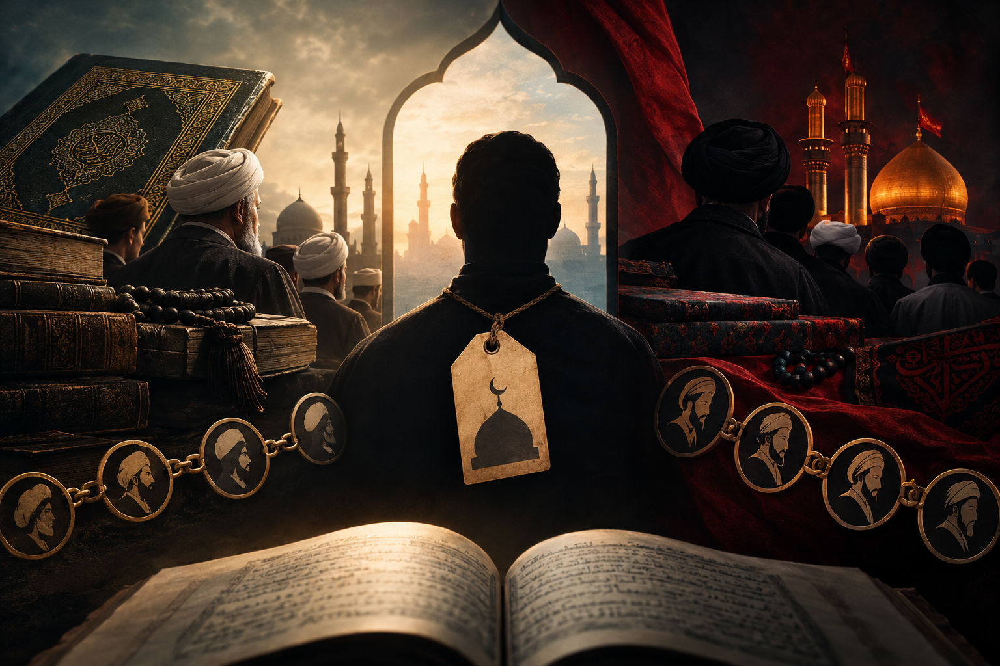

# Когда религию превращают в бренд

*Как суннизм превратил Пророка в разрастающ
уюся систему переданного авторитета, как шиизм выстроил собственную цепочку сакральных посредников и как обе традиции научились контролировать границы веры.*

---

Есть вопрос, на который религиозные привратники редко любят отвечать:

> **Кто дал тебе право решать, кому принадлежать Аллаху?**

Средневековый учёный, современный проповедник, шейх из социальной сети — что именно даёт кому-либо из них право заявлять другому человеку, что тот больше не мусульманин, потому что отвергает определённую интерпретацию, сообщение или богословское учение?

Ислам уделяет большое внимание личной ответственности перед Аллахом. Однако религиозные институты выстроили сложные системы, в которых человеческие авторитеты определяют, что человек обязан принимать, какие толкования считаются допустимыми и кого следует исключить из числа верующих.

В какой-то момент вопрос перестаёт звучать как «Что открыл Аллах?» и превращается в «Во что ты должен верить о том, что открыл Аллах, согласно нашей религиозной традиции?».

Именно здесь религия начинает напоминать не столько отношения с Творцом, сколько бренд с охраняемой идентичностью.

---

## 1. Кому принадлежит Коран?

Рассмотрим аят 42:21:

> «Или у них есть сотоварищи, которые узаконили для них в религии то, чего не дозволил Аллах?»

Этот аят ставит фундаментальный вопрос о религиозной власти. Кто вправе устанавливать религиозные требования, которые Аллах не установил?

Представим, что кто-то говорит тебе:

* «Ты отвергаешь толкование этого учёного, значит, ты неверующий».
* «Ты не признаёшь этот сборник сообщений обязательным источником религии, значит, ты не настоящий мусульманин».
* «Ты должен принимать наше понимание веры, потому что наши учёные уже определили, что означает быть верующим».

Где в Коране этим людям предоставлено право окончательно определять состояние чужой веры перед Аллахом?

Есть разница между утверждением, что чьё-то толкование ошибочно, и притязанием на право определять положение человека перед Аллахом. Первое — обычная часть религиозной дискуссии. Второе — гораздо более серьёзное заявление.

Когда человеческое толкование превращают в обязательное условие принадлежности к исламу, его автор получает особую власть, которую сам ещё должен обосновать.

А когда несогласие с этим толкованием становится доказательством неверия, система начинает защищать собственный авторитет вместо того, чтобы проверять свои утверждения.

Коран 17:36 предостерегает от следования тому, о чём у человека нет знания. Коран 6:164 говорит, что никто не понесёт бремя другого.

Эти принципы ставят перед религиозными привратниками неудобный вопрос: почему человек должен отказываться от самостоятельного суждения в пользу человеческого авторитета, а затем принимать его вердикт так, будто его вынес сам Аллах?

Учёный может объяснять текст. Он может приводить аргументы. Он может оказаться прав или ошибиться.

Но учёная степень не делает человека назначенным Аллахом администратором Рая.

---

## 2. Суннизм: как Пророка превратили в религиозный бренд

Суннитская традиция не отбрасывала Коран. Она сохраняла его, изучала, читала и толковала. Классическая суннитская теория права прямо признаёт Коран и Сунну Пророка основополагающими источниками.

Проблема заключается в другом.

На протяжении столетий огромный корпус сообщений, приписываемых Мухаммаду, стал играть центральную роль в религиозном праве, ритуалах, богословии и повседневной жизни. Эти сообщения описывают то, что Пророк якобы говорил, делал, одобрял или запрещал.

Хадисоведение разработало сложные методы оценки передатчиков и цепочек передачи. Суннитские учёные не принимали без разбора каждое сообщение. Тем не менее история формирования хадисного корпуса остаётся сложной и дискуссионной, а существование методов проверки не гарантирует исторической точности каждого сообщения, признанного достоверным.

Здесь принципиально важно различать два утверждения:

> «Пророк сказал это».

И:

> «Это сообщение было передано и признано достоверным в рамках определённой системы хадисоведения».

Логически это не одно и то же.

Цепочка передатчиков может служить свидетельством. Классификация учёного может отражать обоснованное суждение. Но ни то ни другое автоматически не превращает историческую атрибуцию в несомненный факт.

В религиозной практике это различие, однако, может исчезнуть. Сообщение получает авторитетную классификацию, классификация становится религиозным правилом, а правило со временем превращается в критерий того, является ли человек правильным мусульманином.

И так может продолжаться столетиями, даже если первоначальное историческое утверждение никогда не было независимо подтверждено с достаточной степенью уверенности.

Коран продолжает существовать, но унаследованная система толкований всё чаще определяет, что именно верующий вправе в нём увидеть.

Религия, начавшаяся с откровенного Текста, постепенно может превратиться в религию переданных атрибуций.

А сам Пророк становится своеобразным религиозным брендом: к его имени привязывают правила, запреты, ритуалы и утверждения, которые приобретают авторитет именно потому, что приписываются ему.

Проблема заключается не только в достоверности отдельного хадиса. Вопрос в том, не стала ли система переданных сообщений настолько институционально влиятельной, что сомнение в конкретном сообщении воспринимается как сомнение в самом Пророке.

### Пророк не удостоверял лично каждую книгу, написанную от его имени

Мухаммад не оставил после себя современного, независимо проверяемого каталога всех позднее приписанных ему высказываний с официальным подтверждением каждого сообщения.

Основные суннитские сборники хадисов были составлены после его смерти. Их составители и последующие учёные работали в рамках исторических систем передачи и оценки сообщений.

Этот факт не доказывает, что все сборники ложны. Он означает, что их авторитет опирается на человеческие исторические процессы, которые можно исследовать и ставить под сомнение.

Если кто-то утверждает, что конкретное сообщение устанавливает религиозную обязанность, вопросы вполне очевидны.

Какие есть доказательства того, что Мухаммад действительно это сказал? Насколько надёжна передача? Не противоречит ли сообщение более весомым свидетельствам? Соответствует ли оно историческому контексту? И что доказывает, что сообщение устанавливает универсальную религиозную обязанность, а не описывает конкретную ситуацию?

Эти вопросы не являются нападением на Мухаммада.

Напротив, они необходимы именно потому, что его именем обосновывают религиозную власть.

Защищать репутацию Пророка и принимать любое утверждение, сделанное от его имени, — не одно и то же.

Путаница между этими вещами мешает отличать исторического Мухаммада от накопившихся за столетия традиций последующих общин.

---

## 3. Шиизм: как цепочка сакрального авторитета вышла за пределы Пророка

Шиизм развивался по другому историческому пути.

Ранние споры о руководстве общиной после смерти Мухаммада постепенно привели к конкурирующим представлениям о законной власти. В двунадесятническом шиизме центральное место занял авторитет семьи Пророка, а линия двенадцати имамов приобрела особый богословский статус.

Согласно двунадесятническому учению, имамы не являются новыми пророками. Это различие важно.

Однако им приписываются исключительные религиозные полномочия, включая безошибочность и особое знание, дарованное Аллахом. Их учения и толкования становятся необходимой частью понимания веры.

В результате возникает другая структура религиозного авторитета.

Если суннитские традиции придают огромное значение переданной Сунне Мухаммада и учёности, построенной вокруг неё, то двунадесятнический шиизм отводит центральную роль божественно ведомым имамам и передаче их учений.

Историческая проблема заключается не в том, что шииты уважают семью Пророка. Уважение к родственникам само по себе не доказывает ни их безошибочности, ни божественного назначения.

Вопрос в том, каким образом утверждение об особом положении семьи Пророка превратилось в систему религиозной власти с настолько масштабными богословскими последствиями.

Где Коран прямо называет двенадцать безошибочных имамов? Где он устанавливает, что именно эти люди обладают гарантированным Аллахом авторитетом в вопросах религиозного толкования? Где сказано, что принятие их учений является обязательным условием веры?

Это не второстепенные детали. Это фундаментальные утверждения.

Если ответы на эти вопросы в основном опираются на позднейшие переданные сообщения и богословские толкования, тогда сами источники и толкования необходимо оценивать независимо.

Наличие доктрины внутри определённой традиции ещё не доказывает, что её открыл Аллах.

### Кризис после смерти Хасана аль-Аскари

История двенадцатого имама особенно наглядно показывает, как религиозный авторитет формируется под давлением исторических обстоятельств.

Хасан аль-Аскари, которого двунадесятнические шииты считают одиннадцатым имамом, умер в Самарре в 874 году. После его смерти среди последователей возник кризис преемственности. Исторические источники описывают разногласия о том, кто, если вообще кто-либо, стал его преемником.

Позднее двунадесятническое учение утвердило, что у Хасана был сын по имени Мухаммад, ставший двенадцатым имамом и ушедший в сокрытие ещё ребёнком. Согласно этой доктрине, он продолжает существовать, но недоступен общине, а его Великое сокрытие продолжается по сей день.

Исторические свидетельства о существовании ребёнка и раннем формировании учения о сокрытии остаются предметом дискуссий. Исследования в *Encyclopaedia Iranica* описывают неопределённость вокруг преемственности и возникновение конкурирующих позиций после смерти Хасана.

Во время Малого сокрытия существовала система посредников, через которых, согласно учению, поддерживалась связь между Скрытым имамом и его последователями. История этих представителей и развитие представлений об их полномочиях также исследуются историками.

Всё это поднимает фундаментальный вопрос.

После смерти одиннадцатого имама община столкнулась с серьёзной проблемой преемственности. Разные группы пришли к разным выводам. Одна из этих позиций в конечном счёте стала основанием двунадесятнического шиизма.

Как отличить божественно установленную доктрину от человеческого ответа на исторический кризис?

Сам кризис исторически зафиксирован. Но утверждение, что Аллах разрешил его, скрыв ребёнка, который будет оставаться живым на протяжении столетий, — это богословская интерпретация кризиса, а не независимо установленный исторический факт.

В такую интерпретацию можно верить. Но веру нельзя выдавать за историческое подтверждение.

При этом необязательно доказывать, что доктрину сознательно придумали ради обмана. Само её историческое развитие уже даёт достаточно оснований для вопросов.

Доктрина может возникать под влиянием искренних убеждений, институциональных интересов, унаследованных представлений и необходимости разрешить кризис. Для появления сомнительных религиозных утверждений не обязательно, чтобы все участники были сознательными мошенниками.

Важнее другое: почему доктрина, которую невозможно независимо проверить, должна становиться решающим критерием религиозной идентичности?

### Проблема постоянного посредничества

Скрытый имам считается высшим религиозным авторитетом, однако община живёт в условиях, когда прямой доступ к нему отсутствует.

Возникает практическая проблема: кто определяет религиозные обязанности в его отсутствие?

Двунадесятнический шиизм разработал институты и теории религиозного авторитета, призванные решить эту проблему. Отношения между Скрытым имамом, его историческими представителями и позднейшими религиозными учёными менялись со временем и не сводятся к одной неизменной схеме.

Но структурный вопрос остаётся.

Если высший авторитет недоступен, те, кто толкует его предполагаемые учения, приобретают значительное влияние на общину. Их положение хотя бы отчасти зависит от богословской системы, которая ставит отсутствующего имама в центр религиозной жизни.

Получается, что верующему предлагают доверять человеческим толкователям недоступного авторитета, существование которого и конкретные указания которого невозможно независимо проверить.

Это не делает каждого учёного нечестным. Но сама структура власти заслуживает исследования, а не автоматического подчинения.

Когда религиозные институты вдобавок собирают средства на основании правил, оправдываемых их толкованием религиозного закона, вопрос подотчётности становится ещё конкретнее.

Например, шиитское учение о *хумсе* предусматривает религиозную обязанность выплачивать определённую долю квалифицируемого имущества. Порядок расчёта и распределения зависит от конкретных правовых толкований. Поэтому некорректно описывать *хумс* просто как универсальный налог в двадцать процентов на весь доход каждого человека.

Но само существование подобных финансовых обязанностей делает вопрос религиозного авторитета вполне практическим: кто устанавливает правила, кто распоряжается средствами и чем обосновано его право это делать?

Речь не о том, что каждый религиозный институт эксплуатирует верующих. Речь о том, что богословские утверждения могут иметь реальные финансовые и институциональные последствия, а значит, требуют независимой проверки.

---

## 4. Две традиции, разные авторитеты, одна проблема

Суннизм и двунадесятнический шиизм — не идентичные системы. Их история, доктрины и представления об авторитете существенно различаются.

Было бы неверно утверждать, что сунниты не признают семью Пророка или что шииты просто заменили Аллаха своими имамами.

Обе традиции исповедуют веру в Аллаха. Обе сохраняют Коран. Обе признают Мухаммада последним пророком.

Но общность вероисповедания не решает вопроса о том, каким образом устанавливается религиозный авторитет.

В суннизме переданная Сунна, хадисоведение, правовые школы и учёный консенсус могут становиться мощными механизмами определения ортодоксии.

В двунадесятническом шиизме доктрина авторитета имамов, их безошибочности и Скрытого имама создаёт другую, но не менее значимую структуру.

Опасность в обоих случаях заключается в том, что человеческая система, выстроенная вокруг религиозного авторитета, может стать практически неотделимой от самой религии.

Человек ставит под сомнение сообщение, а разговор превращается в обсуждение того, уважает ли он Пророка.

Человек сомневается в безошибочности имамов, и разговор превращается в обсуждение того, отверг ли он законных божественных наставников.

Человек критикует правовое толкование, и разговор превращается в обсуждение того, имеет ли он вообще право самостоятельно толковать религию.

Заметьте, как меняется предмет дискуссии.

Вместо вопроса «Это правда?» возникает вопрос «Кто ты такой, чтобы это спрашивать?».

Именно так система защищает себя от проверки.

Разговор уходит от доказательств к идентичности. Важно уже не то, насколько обосновано утверждение, а принадлежишь ли ты к правильной группе, доверяешь ли нужным учёным и принимаешь ли унаследованные авторитеты.

В этот момент религиозная идентичность начинает работать как бренд.

---

## 5. Коран и механизм, построенный вокруг него

Коран неоднократно подчёркивает ответственность человека перед Аллахом, важность знания и опасность следования утверждениям без достаточных оснований.

Коран 42:21 ставит под вопрос право устанавливать религиозные требования без разрешения Аллаха.

Коран 17:36 предостерегает от следования тому, о чём у человека нет знания.

Коран 6:164 подчёркивает индивидуальную ответственность.

Эти принципы не отменяют необходимости толкования. Они также не означают, что любое переданное сообщение обязательно ложно или что любой учёный непременно ошибается.

Они устанавливают более фундаментальный вопрос: на каком основании человеческое утверждение считается обязательным в религии?

Если правило представлено как повеление Аллаха, где Коран устанавливает его?

Если правило зависит от сообщения, приписываемого Мухаммаду, что подтверждает достоверность этой атрибуции и обязательность данного сообщения?

Если правило зависит от авторитета имама или учёного, что изначально устанавливает полномочия этого человека?

На эти вопросы нельзя ответить простым указанием на существование традиции, которая уже признаёт данное правило.

Иначе любая религиозная система сможет оправдать себя, сославшись на собственные унаследованные предпосылки.

Коран превращается в текст, который верующим велят принимать, тогда как практический смысл этого текста контролируют авторитеты, чьи собственные утверждения не подвергаются сопоставимой проверке.

В этом и заключается основное противоречие.

Религия, призывающая человека подчиняться Аллаху, не должна требовать, чтобы он воспринимал каждое человеческое толкование религии так, будто это собственная речь Аллаха.

---

## 6. Свобода верующего, который отказывается отдавать Аллаха во владение фракции

Есть разница между отказом от религии и отказом позволить религиозному институту монополизировать её.

Человек может верить в Аллаха, серьёзно относиться к Корану, признавать Мухаммада посланником и при этом сомневаться в исторической достоверности отдельных сообщений или в обоснованности позднейших богословских доктрин.

Это не делает его автоматически неверующим только потому, что религиозный авторитет вынес такой вердикт.

Сам авторитет должен объяснить основания своего решения. Он не может доказать собственную легитимность, объявив несогласие с собой доказательством неверия.

Это особенно важно потому, что религиозное ограничение свободы часто преподносится как защита веры. Институт заявляет, что оберегает ислам от искажений, одновременно представляя собственные унаследованные толкования в качестве стандарта, по которому следует оценивать все остальные.

Но кто защищает верующего от ошибок самого института?

Кто проверяет тех, кто проверяет остальных?

Кто определяет, действительно ли утверждение, приписываемое Аллаху, имеет основание в откровении?

Если ответом всегда становится другой авторитет внутри той же системы, независимого критерия не возникает. Система просто ссылается сама на себя.

Альтернатива не в том, чтобы объявить безошибочным самого себя или отвергнуть любую учёность. Она заключается в отказе смешивать человеческий авторитет с божественным.

Учёный может помочь понять Коран. Историк может помочь оценить сообщение. Богослов может привести аргументы в пользу доктрины имамата. Но ни один из них не становится Творцом, выполняя эти задачи.

Свобода, о которой идёт речь, — не свобода от мышления. Это свобода от требования считать самостоятельное мышление религиозным преступлением.

---

## Заключение. Аллах — не торговая марка

Суннитская традиция создала огромную систему авторитета вокруг сообщений, приписываемых Пророку. Двунадесятнический шиизм развил учение о божественно ведомых имамах и систему религиозной власти, сосредоточенную вокруг Скрытого имама.

Их история различается, а их доктрины нельзя сводить к одному и тому же. Но обе традиции сталкиваются с одним вопросом всякий раз, когда человеческие толкования превращаются в условия принадлежности к исламу:

> **В какой момент авторитет религиозной традиции стал неотличим от авторитета Аллаха?**

Имя Мухаммада не удостоверяет автоматически каждое высказывание, приписываемое ему. Семья Пророка не может доказать безошибочность своих потомков одним лишь происхождением. Репутация учёного не превращает толкование в откровение. А религиозный институт не может доказать, что говорит от имени Аллаха, просто объявив своих критиков чуждыми вере.

Коран не принадлежит секте. Аллах не принадлежит духовному институту. Религиозная идентичность — не торговая марка, с помощью которой одна группа может контролировать доступ к Творцу.

Самый независимый верующий — не обязательно тот, кто отвергает всех учёных и любые традиции. Это тот, кто отказывается стирать различие между тем, что открыл Аллах, и тем, что люди утверждают от имени Аллаха.

Вопрос не в том, заботятся ли сунниты или шииты об Аллахе. Миллионы людей в обеих традициях искренне верят в Него.

Вопрос в том, может ли искренность оправдать превращение человеческого религиозного авторитета в нечто неприкосновенное.

Не может.

Пророческая миссия завершилась. История продолжилась. И ни один человеческий институт не стал Аллахом только потому, что объявил себя Его представителем.

---

## Источники

* **Коран:** 6:164; 17:36; 42:21.
* **Encyclopaedia Iranica.** *Hadith: A General Introduction*.
* **Hallaq, Wael B.** *On the Authoritativeness of Sunni Consensus*.
* **Encyclopaedia Iranica.** *Islam in Iran: The Deputies of Mahdi*.
* **Encyclopaedia Iranica.** *The Concept of Mahdi in Twelver Shi'ism*.
* **Encyclopaedia Iranica.** *Askari: Abu Mohammad Hasan b. Ali*.
