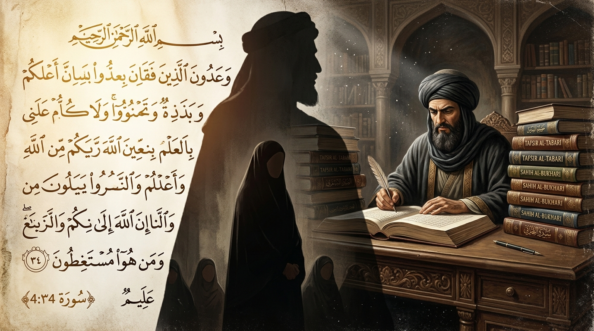

# Мачистские тафсиры и переход к исламу, ориентированному на хадисы

*Как передаваемые сообщения превратились в авторитетные источники толкования — и как средневековые представления о гендерных ролях обрели религиозную легитимность.*

---

## Введение: когда комментарий становится авторитетнее самого текста

Прочитайте Коран, не открывая классический тафсир, — и одно привычное предположение станет гораздо труднее поддерживать: будто каждое правило, традиционно представляемое как «исламское», можно найти в самом Коране в ясно сформулированном виде.

Некоторые из наиболее значимых правил, регулирующих гендерные отношения, брак, сексуальность и семейную жизнь, опираются не только на коранические аяты, но и на многочисленные слои передаваемых сообщений, правовых рассуждений и унаследованных интерпретаций. Во многих традиционных религиозных средах эти слои рассматриваются не как необязательные исторические комментарии, а как авторитетные объяснения того, что именно имел в виду Бог.

Это поднимает вопрос, заслуживающий гораздо большего внимания:

> **Что происходит, когда толкование текста приобретает такой авторитет, что сам текст уже не может поставить это толкование под сомнение?**

Проблема заключается не просто в том, что классические мусульманские учёные были мужчинами, жившими в патриархальных обществах. Это наблюдение имеет значение, но само по себе недостаточно. Более глубокая проблема носит методологический характер: какие источники допускались к определению смысла, каким интерпретациям отдавался приоритет и каким образом унаследованные сообщения могли становиться основанием для правил, которые сам Коран прямо не формулирует?

Переход к религиозному авторитету, сосредоточенному на хадисах, не был делом одного человека или результатом единого исторического заговора. Он происходил по мере развития критики хадисов, исламской юриспруденции, толкования Корана и институтов религиозного образования. Однако сложившаяся система создала мощный механизм, посредством которого представления прежних обществ проникали в религиозное право и становились труднодоступными для критики.

Последствия особенно заметны в классических толкованиях положения женщин.

---

## 1. Аль-Бухари не изобрёл эту систему, но его сборник стал частью её инфраструктуры

Мухаммад ибн Исмаил аль-Бухари, умерший в 870 году, жил в эпоху Аббасидов, когда мусульманские учёные активно спорили об авторитете передаваемых сообщений, правовых рассуждениях, теологии и достоверности преданий, приписываемых Мухаммаду.

Он был не просто собирателем рассказов. Его *Сахих* отражает сложный научный проект: оценку передатчиков, изучение цепочек передачи, тематическую систематизацию сообщений и использование заголовков глав для выражения правовых и теологических суждений.

Со временем сборник приобрёл исключительный авторитет в суннитском исламе. Однако этот авторитет нельзя переносить в прошлое так, будто все мусульманские общины с самого начала считали его бесспорным вторым основанием религии.

Аль-Бухари не изобрёл хадисы и не создал более широкое движение к опоре на передаваемые сообщения. Его сборник стал одним из наиболее влиятельных результатов процесса, который начался задолго до него.

Это различие важно, поскольку историческая проблема гораздо шире личности самого аль-Бухари.

### Цепочка передачи и содержание сообщения

В критике хадисов развились сложные методы исследования передатчиков и цепочек передачи, известных как *иснад*. Учёные выясняли, считались ли рассказчики надёжными, могли ли они встречаться друг с другом и могло ли сообщение правдоподобно пройти по указанной цепочке.

Значение имело и содержание сообщения — *матн*. Поэтому было бы неверно утверждать, что аль-Бухари и его современники просто игнорировали смысл передаваемых текстов. Исследование Джонатана Брауна документирует существование критики содержания в ранней хадисоведческой традиции, хотя такая критика иногда выражалась через технические оценки передачи (Brown, *“How We Know Early Hadīth Critics Did Matn Criticism and Why It’s So Hard to Find”*).

Но принципиальное различие остаётся.

Установить, что сообщение было передано по признанной надёжной цепочке, — не то же самое, что независимо установить историческую достоверность его приписывания Мухаммаду, неизменность его формулировки или обоснованность выводимых из него правовых последствий.

Это разные вопросы. Анализ иснада помогает решать один класс проблем, но автоматически не разрешает все остальные вопросы исторической атрибуции, интерпретации и нормативного авторитета.

Надёжная цепочка передачи также не устраняет социальные предпосылки, заложенные в самом сообщении.

Предание может признаваться достоверным в рамках определённой научной традиции и при этом требовать критического изучения: что оно означает, как соотносится с Кораном и насколько обоснованны выводы, которые из него делают.

Чем более авторитетным становится сборник, тем серьёзнее последствия этих различий.

---

## 2. От источника свидетельств к инстанции, определяющей смысл Корана

Решающим изменением стало не просто сохранение мусульманами сообщений о Мухаммаде. Происходила постепенная институционализация иерархии религиозных доказательств, в которой передаваемая сунна Пророка становилась необходимым инструментом толкования Корана и выведения религиозно-правовых норм.

Классическая суннитская теория толкования в целом ставила на первое место Коран, затем объяснения и практику Пророка, сообщения от сподвижников и последующие учёные интерпретации. Конкретная иерархия и её применение различались, однако принцип толкования Корана через передаваемый авторитет приобрёл огромное влияние.

Сам по себе такой подход не был иррациональным. Исторический контекст и надёжные свидетельства могут прояснять неоднозначный отрывок. Проблема начинается тогда, когда авторитет передаваемого сообщения считается достаточным основанием для преодоления очевидного смысла Корана, а сам Коран при этом не может служить действенным критерием проверки интерпретации.

Показательно изречение, часто приводимое в связи с этой иерархией:

> *Al-sunna qadiya 'ala al-kitab, wa-laysa al-kitab qadiyan 'ala al-sunna* — «Сунна судит Книгу, но Книга не судит сунну».

В традиционных обсуждениях это изречение приписывается ранним авторитетам, хотя к его точному происхождению и придаваемому ему смыслу необходимо относиться внимательно. Его нельзя считать простым выражением позиции каждого суннитского учёного.

Тем не менее лежащее в его основе методологическое противоречие вполне реально. Если сунна может определять смысл и правовые пределы Корана, но Коран не может ставить под сомнение достоверность или нормативные последствия сообщения, такая иерархия становится труднодоступной для критики изнутри самой системы.

Книга может формально провозглашаться высшим авторитетом, тогда как другой корпус литературы фактически определяет, как эту книгу следует понимать.

### Пример побивания камнями

Рассмотрим Коран 24:2, предписывающий сто ударов плетью мужчине и женщине, совершившим *зина* — незаконную половую связь. Сам аят не устанавливает отдельного наказания в виде побивания камнями для состоящих в браке нарушителей.

Тем не менее классическая суннитская юриспруденция признаёт побивание камнями наказанием для определённых категорий состоящих в браке нарушителей, опираясь на передаваемые сообщения и правовые рассуждения.

В хадисе *Сахих аль-Бухари* 6829 приводится сообщение, приписываемое Умару. Согласно ему, Умар опасался, что со временем люди станут говорить, будто не находят побивания камнями в Книге Бога, и поэтому откажутся от предписания, которое он называет установленным Богом. Затем он подтверждает это наказание для состоящего в браке нарушителя при определённых условиях доказывания.

Традиционные правоведы предлагали объяснения, связанные с отменой чтения определённого аята при сохранении его правового предписания, а также с полномочиями сунны Пророка уточнять или дополнять кораническое законодательство. Это признанные элементы классической правовой теории, а не просто отговорки, придуманные современными апологетами.

Но они также выявляют фундаментальный вопрос.

Если наказание не сформулировано в сохранившемся тексте Корана, но считается установленным Богом на основании передаваемых сообщений, что обосновывает авторитет этого предписания — и какие свидетельства могли бы правомерно поставить его под сомнение?

Сторонник кораноцентричного подхода может отвергнуть традиционное согласование этих положений. Традиционный правовед может его принять. Но исторический спор нельзя разрешить одним лишь заявлением, что сообщение достоверно в рамках определённой хадисоведческой методологии. Необходимо также обосновать представление о соотношении Корана, передачи сообщений и правового авторитета.

Аль-Бухари не создал эту систему отношений единолично. Его сборник стал одним из институтов, посредством которых она сохранялась и укреплялась.

---

## 3. Как тафсир стал носителем социальных представлений

Кораническая экзегеза, или *тафсир*, развивалась не в культурном вакууме. Её авторы наследовали языковые нормы, правовые дискуссии, передаваемые повествования и представления об устройстве общества, в котором они жили.

Крупные классические комментаторы часто были глубоко образованными учёными. Они сохраняли различные толкования, сопоставляли сообщения и проводили сложный лингвистический и правовой анализ. Их труды не взаимозаменяемы, и сводить их к единой мизогинной доктрине было бы неправильно.

Однако их интерпретации также отражают интеллектуальную среду, в которой они работали.

Ат-Табари, умерший в 923 году, создал один из основополагающих трудов суннитской коранической экзегезы — *Джами аль-баян*. Он сохранил обширный корпус передаваемых толкований, одновременно вынося собственные суждения при выборе между конкурирующими объяснениями. Ибн Касир, умерший в 1373 году, приобрёл особое влияние благодаря опоре на передаваемые сообщения и методу толкования Корана посредством Корана, хадисов и высказываний ранних авторитетов.

Эти методы позволяли сохранять ценные исторические и лингвистические материалы. Но они также могли переносить унаследованные социальные представления в толкование откровения.

Для этого комментатору не нужно сознательно искажать Коран. Учёный может искренне считать определённое сообщение авторитетным, полагать, что предыдущее поколение правильно поняло аят, и воспринимать устоявшиеся правовые категории как отражение божественной мудрости. Если исходить из этих предпосылок, толкование, укрепляющее существующую гендерную иерархию, может выглядеть не культурным предпочтением, а очевидным религиозным выводом.

Таким образом, процесс толкования может развиваться по замкнутому кругу:

1. В обществе существуют устоявшиеся представления о ролях мужчин и женщин.
2. Передаваемые сообщения отбираются, признаются достоверными и интерпретируются в рамках соответствующей интеллектуальной среды.
3. Толкователи используют эти сообщения для объяснения коранических отрывков.
4. Правоведы превращают некоторые интерпретации в юридические нормы.
5. Последующие поколения знакомятся с этими нормами уже как с унаследованным смыслом откровения.

В результате возникает мощная историческая обратная связь. Социальные представления влияют на толкование, а толкование наделяет эти представления религиозным авторитетом.

Именно поэтому история тафсира имеет такое значение. Это не просто история того, как учёные понимали смысл Корана. Это также история формирования границ допустимого религиозного толкования.

---

## 4. Гендерный вопрос: прочтение Корана через мужскую правовую традицию

Гендерные последствия особенно заметны при изучении аятов о браке, семейной власти, наследовании и правовом положении женщин.

Рассмотрим Коран 4:34, в котором используется термин *каввамун* при описании отношений мужчин и женщин. Этот аят вызвал широкие споры о том, обозначает ли термин финансовую ответственность, власть, защиту или более общую иерархию между полами.

Классические комментаторы часто толковали этот аят в рамках социальной модели, в которой муж обладал властью над женой и нёс определённые финансовые обязательства. Их интерпретации различались, но многие помещали этот отрывок в контекст уже сложившейся патриархальной структуры семьи.

Современные толкователи оспаривают подобные предпосылки. Они утверждают, что аят следует читать в совокупности с более широким этическим словарём Корана, его представлениями о взаимной ответственности и признанием женщин самостоятельными моральными субъектами. Другие считают традиционное иерархическое прочтение наиболее верным.

Важен исторический вывод: аят не толкует сам себя. Его смысл зависит от решений о языке, контексте, передаваемых сообщениях, правовых прецедентах и относительном авторитете каждого из этих источников.

Та же проблема возникает при обсуждении Корана 2:282, посвящённого свидетельству в контексте долговых обязательств с отсроченным исполнением, и Корана 4:11, регулирующего доли наследства. Эти аяты рассматривают конкретные правовые вопросы, однако их толкование иногда становилось основанием для более широких утверждений об общей интеллектуальной или социальной неполноценности женщин.

Такой переход требует обоснования. Правило о свидетельстве в определённом договорном контексте само по себе не устанавливает универсальную иерархию интеллекта. Предписанная доля наследства сама по себе не решает все вопросы о моральном, интеллектуальном или социальном положении женщин.

Когда комментаторы или правоведы переходят от конкретного текста к обобщённому утверждению о женщинах, логика такого перехода заслуживает отдельного рассмотрения.

Исследования классической экзегезы всё чаще анализируют андроцентрические предпосылки, обнаруживаемые во влиятельных толкованиях аятов о гендерных отношениях. В сборнике под редакцией Асмы Афсаруддин *The Oxford Handbook of Islam and Women* представлены исследования классической экзегезы и современных подходов к гендерному прочтению, включая главы о традиционных толкованиях коранических аятов о женщинах и современных переосмыслениях Корана и хадисов с учётом гендерной проблематики (Oxford University Press, *The Oxford Handbook of Islam and Women*).

Вопрос не в том, что каждый классический комментатор был настроен против женщин. Вопрос в том, почему интерпретации, сформированные исторически обусловленными представлениями о гендере, впоследствии стали восприниматься как вневременное выражение божественного замысла.

### Различие между утверждением Корана и расширением, внесённым толкователем

В популярном религиозном обучении это различие часто теряется.

Коранический аят может устанавливать определённое правило. Затем комментатор ссылается на сообщение, мнение раннего авторитета или правовой принцип, чтобы объяснить это правило. Позднейшие читатели могут повторять объяснение комментатора, уже не отличая его от самого аята.

В конечном счёте расширенное толкование может стать стандартным пониманием коранического отрывка.

Исходный текст не изменился. Но окружающая его система интерпретаций приобрела настолько сильный авторитет, что альтернативные прочтения начинают восприниматься как отход от самой религии.

Так историческое толкование приобретает вид вечного предписания.

---

## 5. Почему выражение «мачистский тафсир» — не просто оскорбление

Термин «мачистский тафсир» носит полемический характер, но указывает на серьёзный аналитический вопрос: в какой момент толкование Корана начинает воспроизводить общественную иерархию, построенную вокруг мужского доминирования, а затем представлять её как установленную Богом?

На этот вопрос нельзя ответить простым подсчётом мужчин среди комментаторов. Мужчина-учёный может оспаривать патриархальные предпосылки, а женщина-учёный — воспроизводить их. Само присутствие хадиса в комментарии также не делает интерпретацию женоненавистнической.

Важны более конкретные вопросы:

* Различает ли толкование то, что Коран прямо утверждает, и то, что добавляют позднейшие сообщения?
* Передаваемые сообщения подвергаются критическому анализу или считаются решающими только потому, что входят в признанный сборник?
* Оцениваются ли сообщения и интерпретации последовательно — независимо от того, поддерживают они существующую гендерную иерархию или ставят её под сомнение?
* Превращается ли конкретное правовое правило в необоснованное утверждение об общей неполноценности женщин?
* Рассматриваются ли альтернативные интерпретации по существу или отвергаются лишь потому, что противоречат унаследованному авторитету?

Эти вопросы превращают лозунг в метод анализа.

Они также показывают, почему толкование, ориентированное на хадисы, может укреплять патриархат без какого-либо сознательного заговора. Если сообщение признаётся авторитетным, содержащиеся в нём социальные представления могут проникать в толкование коранического аята. Если получившаяся интерпретация закрепляется в праве и религиозном обучении, исходное сообщение начинает влиять на жизнь людей, которые никогда его не читали.

Авторитет сообщения выходит за пределы его роли исторического источника. Оно становится частью механизма, посредством которого формируются религиозные нормы.

---

## 6. Персидская империя не изобрела патриархат, а Аббасиды не изобрели хадисы

Одно из соблазнительных объяснений приписывает патриархальный характер классического исламского толкования слиянию арабской племенной культуры, персидских имперских традиций и религиозной политики Аббасидов.

Здесь есть исторический вопрос, заслуживающий изучения: как социальные институты расширявшейся империи влияли на правовые рассуждения, семейные нормы, придворную культуру и религиозную учёность?

Однако широкое утверждение, будто персидский феодализм извратил изначально эгалитарный Коран, не является удовлетворительным историческим объяснением. Патриархальные социальные структуры существовали в Аравии и в более широком позднеантичном мире задолго до эпохи Аббасидов. Персидское общество также не было единой, однородной системой мужского господства, с помощью которой можно объяснить каждую последующую мусульманскую доктрину.

В аббасидский период действительно расширялись сети учёных, развивались правовые школы, распространялась передача хадисов и создавались влиятельные труды по толкованию Корана. Эти процессы происходили в многонациональной империи, но их нельзя свести к заимствованию одной чужеземной идеологии.

Более обоснованный аргумент заключается в том, что мусульманские учёные толковали откровение в обществах, где власть мужчины в семье уже была привычной социальной нормой. Их интеллектуальные инструменты включали унаследованные сообщения, правовые рассуждения, лингвистический анализ и мнения предшествующих авторитетов. Эти инструменты могли сохранять представления окружающего мира даже тогда, когда сам коранический текст допускал более широкий спектр толкований.

Это различие важно, поскольку историческое объяснение должно выявлять реальные механизмы, а не возлагать коллективную вину на этническую или цивилизационную группу.

Вопрос не в том, что «персы» испортили ислам. Вопрос в том, как определённые интерпретации приобрели авторитет, как правовые и экзегетические институты укрепляли друг друга и почему одни толкования получили преимущество перед альтернативами.

---

## 7. Более глубокая проблема: религиозный авторитет без действенного права на обжалование

Наиболее значимое последствие толкования, ориентированного на хадисы, заключается не в том, что мусульмане сохраняли сообщения о Мухаммаде. Проблема в том, что последующие системы авторитета могли сделать эти сообщения практически неоспоримыми даже тогда, когда их последствия, казалось, противоречили прочтению Корана, при котором он служит главным критерием.

Когда сборник приобретал канонический статус, его сообщения могли включаться в правовые аргументы, кораническую экзегезу, религиозное образование и популярные проповеди. Когда комментарий становился авторитетным, его интерпретацию могли повторять так, словно она и была самим текстом. Когда правовая доктрина закреплялась внутри школы, сомнения в её историческом происхождении могли восприниматься как сомнения в религии в целом.

Таким образом, система создала проблему подотчётности.

Если Коран признаётся божественным откровением, но его практический смысл определяется корпусом человечески передаваемых материалов, какие гарантии препятствуют тому, чтобы эти материалы приобрели статус, которого сам Коран прямо им не присваивает?

Традиционный ответ апеллирует к авторитету сунны Пророка, надёжности хадисоведческой науки и преемственности правовой традиции. Это исторически значимые аргументы, но они не подтверждают сами себя. Они зависят от предварительных суждений о надёжности передачи сообщений, соотношении откровения и пророческого прецедента, а также авторитете позднейших учёных.

Критический подход предлагает открыто рассматривать эти вопросы. Он различает историческое существование сообщения и достоверность его приписывания, достоверность приписывания и обоснованность толкования, а также обоснованность толкования и справедливость или необходимость выведенного из него правового предписания.

Эти различия не гарантируют, что каждое кораноцентричное толкование будет верным. Но они не позволяют унаследованному авторитету служить собственным окончательным доказательством.

---

## Заключение: когда человеческое толкование становится священным

Аль-Бухари не создал ислам, ориентированный на хадисы, единолично. Он работал в рамках уже сложившегося научного движения, а его сборник стал одним из наиболее влиятельных достижений этого движения. Ранние критики хадисов не отказывались от анализа содержания сообщений, а классические толкователи не всегда сознательно стремились подчинить женщин.

Эти уточнения не устраняют центральную проблему. Напротив, они позволяют точнее её определить.

Развитие авторитета хадисов, распространение экзегезы, основанной на передаваемых сообщениях, и институционализация исламской юриспруденции создали систему, в которой сообщения, приписываемые Мухаммаду, могли определять практический смысл коранических аятов. Внутри этой системы интерпретации, сформированные исторически обусловленными представлениями о гендере, могли приобретать религиозную легитимность и становиться трудноотличимыми от самого откровения.

Последствия не ограничивались положением женщин, но именно гендерная проблематика представляет собой особенно наглядный пример. Она показывает, как авторитет сообщения влияет на толкование аята, как интерпретация превращается в правовую норму и как эта норма впоследствии преподносится как вневременная религиозная истина.

Поэтому главный вопрос заключается не в том, следует ли изучать хадисы или заслуживают ли классические учёные безоговорочного осуждения. Вопрос в том, можно ли выводить какое-либо человеческое толкование за пределы содержательной критики лишь потому, что оно приобрело канонический статус.

Текст может быть священным для своих читателей, тогда как его толкователи остаются людьми, сформированными конкретной исторической эпохой. Смешение этих двух вещей превращает критику в подобие святотатства, а унаследованный обычай — в откровение.

Коран не написал собственные средневековые комментарии. Их написали люди. И авторитет этих комментариев необходимо исследовать так же тщательно, как и утверждения, которые они выдвигают относительно текста.

Пророческая миссия завершилась. История толкования продолжилась.

---

## Избранные источники и дополнительная литература

1. **Brown, Jonathan A. C.** “How We Know Early Hadīth Critics Did Matn Criticism and Why It’s So Hard to Find.” *Islamic Law and Society* 15, no. 2 (2008): 143–184. Исследование ранней критики хадисов и взаимосвязи анализа иснада и матна.
2. **Brown, Jonathan A. C.** *Hadith: Muhammad’s Legacy in the Medieval and Modern World*. Oneworld Publications, 2009. Доступное введение в историю хадисов, методы установления их достоверности и их авторитет в религиозной традиции.
3. **McAuliffe, Jane Dammen.** “Quranic Hermeneutics: The Views of al-Ṭabarī and Ibn Kathīr.” В сборнике *Approaches to the History of the Interpretation of the Qur’an*, под редакцией Andrew Rippin. Oxford University Press, 1988.
4. **Afsaruddin, Asma, ed.** *The Oxford Handbook of Islam and Women*. Oxford University Press, 2023. Содержит исследования классической экзегезы, положения женщин в хадисной литературе и современных гендерно-ориентированных прочтений Корана и хадисов.
5. **Аль-Бухари.** *Сахих аль-Бухари*, хадис 6829. Первичный источник для изучения сообщения, приписываемого Умару, о побивании камнями и соотношении коранического текста с передаваемым правовым авторитетом.
6. **Коран**, в особенности 2:282, 4:11, 4:34 и 24:2. Эти аяты служат отправной точкой для сопоставления коранических формулировок с интерпретациями и правовыми доктринами, сформировавшимися вокруг них.
