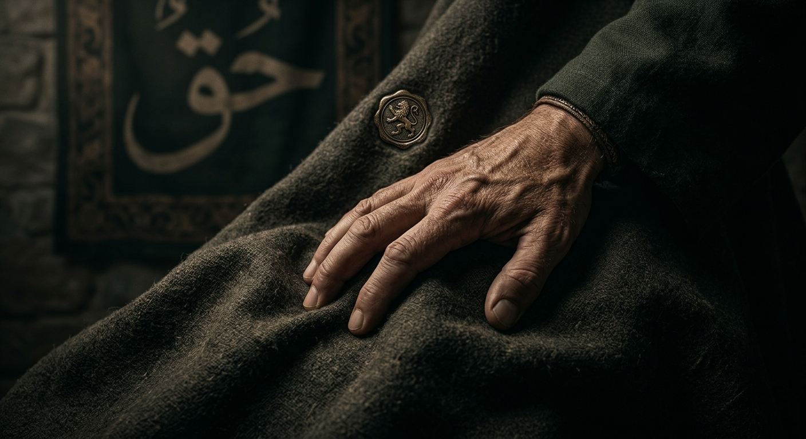

# Почему мужчины так отчаянно пытаются приписать Аллаху обязательство хиджаба, если этот закон их не касается?

*Небольшие размышления вслух о мужской психологии, религиозном контроле и странной потребности объявлять Божьими законами правила, ограничивающие чужую жизнь.*

---

Сегодня у меня немного другой формат. Это скорее не академическая статья, а размышления вслух. Поэтому здесь будет меньше сухого изложения и больше прямоты. Не эмоциональных выпадов, а именно прямоты — без необходимости каждый раз оборачивать очевидный вопрос в три слоя академической ваты.

Недавно в сабреддите *AcademicQuran* я наткнулся на очередного «академика», который критиковал другого исследователя и одновременно пытался доказать обязательность хиджаба. Как обычно, довольно быстро подтянулась знакомая публика: снобистские комментарии, демонстрация интеллектуального превосходства, обещания кого-то куда-то «подтянуть», ссылки на авторитеты и прочие атрибуты интернет-академизма.

Я заметил и дубликат этого поста в другом сабреддите. Там один пользователь задал автору вполне конкретные вопросы. Но исследователь предпочёл их проигнорировать. Ничего удивительного: иногда гораздо приятнее демонстрировать собственную научную состоятельность перед аудиторией, чем отвечать на неудобные вопросы.

И здесь есть ещё одна вещь, которую давно пора называть своими именами. Значительная часть того, что в подобных дискуссиях преподносится как «исламоведение», на деле является историческим изучением религиозной традиции: кто, когда и как интерпретировал Коран, какие представления существовали в разные эпохи, как формировались нормы и каким образом одни толкования получали преимущество над другими.

Это вполне легитимный предмет исследования. Но изучение истории того, как люди понимали и интерпретировали Коран, само по себе не превращает их интерпретации в Божьи предписания. Историк может установить, что определённое понимание существовало тысячу лет назад. Он не может одним этим фактом доказать, что именно этого требует Аллах.

Но меня в той дискуссии заинтересовал даже не очередной спор о значении слов или исторических источниках.

Меня заинтересовал другой вопрос.

> **Почему некоторые мужчины настолько отчаянно пытаются приписать Аллаху обязательство хиджаба, если сам закон, который они защищают, не возлагает на них эту обязанность?**

Давайте посмотрим на ситуацию без привычных религиозных декораций.

Мужчина не носит этот платок. Его не штрафуют за отсутствие головного покрытия. Ему не приходится ежедневно учитывать его при выборе одежды, работе, передвижении или общении с окружающими. Если женщина решает его не носить, непосредственные ограничения и общественное давление в первую очередь направляются на неё.

Так почему же мужчина может часами спорить, искать аргументы, привлекать авторитеты и защищать обязательность этой нормы с такой настойчивостью, будто речь идёт о его собственной судьбе?

Снимет ли его жена платок после очередной дискуссии? Скорее всего, нет. Для многих женщин хиджаб уже давно стал частью личной идентичности, привычного образа жизни и принадлежности к определённой религиозной среде. А если речь о матери, сестре или дочери, то мужчина может вообще не иметь намерения менять их образ жизни.

Тогда зачем ему так необходимо доказать, что это приказ Аллаха?

У меня есть несколько предположений.

---

## 1. Контроль, который не хочется называть контролем

Начнём с самого очевидного.

В патриархальной модели общество привыкло рассматривать женскую одежду не просто как личный выбор женщины, а как вопрос семейной чести, мужской ответственности и общественной морали. Женское тело становится территорией, вокруг которой выстраиваются правила, ожидания и ограничения.

И вот здесь появляется удобная конструкция: мужчина не просто предпочитает, чтобы женщина одевалась определённым образом. Он объявляет, что этого требует сам Аллах.

Разница огромная.

В первом случае перед нами человеческое предпочтение. Его можно обсуждать, оспаривать и отвергать. Во втором случае любое несогласие уже пытаются представить как неповиновение Богу.

Это чрезвычайно удобный способ легитимировать контроль. Мужчине больше не нужно объяснять, почему он считает определённую одежду обязательной. Он просто заявляет: «Это не моё мнение. Так велел Аллах».

И теперь попробуй возразить.

Проблема даже не в том, что каждый такой мужчина обязательно сознательно стремится контролировать женщин. Многие вполне искренне считают свои убеждения религиозной истиной. Но искренность не отменяет психологической функции убеждения. Человек может совершенно искренне защищать систему, которая обеспечивает ему привычное положение и ощущение порядка.

---

## 2. Ему нужно, чтобы это приказал именно Аллах

Здесь, на мой взгляд, находится самое интересное.

Представим мужчину, который хочет, чтобы его жена носила хиджаб. Он может считать это красивым, правильным, скромным или соответствующим его представлениям о семье.

Но есть одна проблема: это его человеческое мнение.

Если же он убеждён, что хиджаб обязателен по воле Аллаха, его личное предпочтение получает совершенно другой статус. Теперь он не просто мужчина со своими взглядами. Он человек, который якобы защищает Божий закон.

Это снимает с него необходимость отвечать на неудобный вопрос: **на каком основании ты решил, что вправе требовать этого от другого человека?**

Вместо собственного обоснования появляется ссылка на высшую инстанцию.

Психология давно изучает, как люди используют внешние авторитеты для оправдания собственных решений и убеждений. Это не означает, что всякая религиозная убеждённость является самооправданием. Но механизм хорошо знаком: человеку гораздо легче воспринимать собственную позицию как безусловную истину, когда он связывает её с авторитетом, который не допускает возражений.

В данном случае этот авторитет — Аллах.

Именно поэтому спор о хиджабе для некоторых мужчин превращается во что-то гораздо большее, чем обсуждение одежды. Они защищают не только конкретное правило. Они защищают право считать собственное представление о правильной жизни выражением Божьей воли.

---

## 3. Страх перед разрушением привычной картины мира

Есть ещё один механизм — потребность в определённости.

Психологи называют его *need for cognitive closure*, то есть потребностью в когнитивной определённости. В упрощённом виде это стремление получить ясный, окончательный ответ и избавиться от неопределённости.

Для человека, привыкшего к жёсткой религиозной системе, мир устроен довольно просто: есть разрешённое и запрещённое, правильное и неправильное, благочестивое и греховное. Каждая вещь должна иметь своё место.

И вдруг кто-то задаёт вопрос: а где именно в Коране сказано, что женщина обязана покрывать волосы?

Вместо того чтобы спокойно проверить текст, человек может воспринимать сам вопрос как угрозу всей привычной системе.

Потому что если одно из якобы бесспорных правил оказывается человеческой интерпретацией, возникает неприятная перспектива: а сколько ещё таких правил?

Это уже не просто вопрос о платке. Это вопрос о надёжности всей конструкции, в которой человек привык жить.

Исследования когнитивного диссонанса показывают, что столкновение убеждений с противоречащей им информацией может вызывать психологический дискомфорт. Люди нередко пытаются устранить его не пересмотром убеждений, а поиском дополнительных оправданий и аргументов в пользу прежней позиции.

Поэтому иногда проще найти ещё одну статью, ещё одного исследователя и ещё одну интерпретацию, чем допустить, что привычное правило никогда не было так очевидно обосновано, как казалось.

---

## 4. Хиджаб как знак принадлежности и морального превосходства

Есть и социальная сторона вопроса.

В некоторых религиозных сообществах хиджаб давно стал не только элементом одежды, но и заметным маркером идентичности. Он может обозначать принадлежность к определённой среде, демонстрировать религиозную приверженность и отделять «своих» от «чужих».

Для части людей это ещё и символ морального статуса.

Женщина в платке может восприниматься как более скромная, правильная или благочестивая. А её семья — как более религиозная. Мужчина в такой системе тоже получает символический бонус: его семья соответствует установленному образцу благочестия.

И здесь возникает неприятный вопрос: что именно человек защищает — религиозное предписание или социальную иерархию, в которой его семья занимает удобное место?

Разумеется, не каждая женщина носит хиджаб ради статуса, и не каждый мужчина воспринимает его как знак собственного превосходства. Но социальная функция символов от этого никуда не исчезает.

Когда внешний признак становится мерилом нравственности, возникает опасная подмена: человека начинают оценивать не по его поступкам, честности, справедливости и отношению к другим, а по тому, насколько хорошо он соответствует видимому стандарту.

Платок становится заметнее характера. А контролировать платок гораздо проще, чем воспитывать совесть.

---

## 5. Академический авторитет как новая религиозная дубинка

И вот мы возвращаемся к той самой дискуссии.

Особенно забавно наблюдать, как некоторые люди, демонстративно дистанцирующиеся от традиционных религиозных авторитетов, тут же начинают использовать академические имена как новую форму неприкосновенного авторитета.

Раньше аргумент звучал так: «Так сказал шейх».

Теперь он звучит так: «Так доказал профессор».

Но логическая проблема никуда не исчезла.

Исследователь может быть прекрасным историком, знатоком арабского языка или специалистом по ранним мусульманским источникам. Это не делает его интерпретацию автоматически обязательной для верующего. Академическая квалификация помогает оценивать качество исследования, но не наделяет человека правом объявлять собственное прочтение Божьим законом.

И если человек не способен ответить на конкретный вопрос, ссылка на его учёную степень ничего не меняет.

Более того, историческое исследование может показать, насколько неоднородными были представления о женской одежде в разные эпохи и как постепенно закреплялись определённые нормы. Но даже если мы установим, что конкретная интерпретация была широко распространена, это доказывает её историческое влияние, а не её божественное происхождение.

> **История объясняет, как сформировалось убеждение. Она не превращает это убеждение в откровение.**

Именно эту границу некоторые люди почему-то так не любят замечать.

---

## 6. А что, собственно, говорит Коран?

Всё это подводит нас к самому простому вопросу, который почему-то постоянно теряется за бесконечными дискуссиями об авторитетах.

Где именно Коран устанавливает обязательное покрытие женских волос?

В 24:31 говорится о *хумур* и о том, чтобы женщины направляли их на свои *джуюб* — область выреза одежды, груди и декольте. В тексте есть конкретное указание относительно одежды и открытой области груди. Но прямого приказа покрывать волосы в этом аяте нет.

В 33:59 говорится о *джалабиб* и о том, чтобы женщины опускали их на себя. Этот аят также обсуждается в контексте внешней одежды, но сам по себе не содержит прямой формулировки «покрывайте волосы».

Можно спорить о лексике, историческом контексте и значении этих слов. Но нельзя подменять один вопрос другим.

Исторический факт, что женщины в определённые эпохи покрывали голову, не равен доказательству того, что Аллах установил это как универсальную религиозную обязанность.

И если кто-то утверждает обратное, пусть покажет сам приказ, а не пытается заменить его многовековой историей интерпретаций.

В конце концов, вопрос не в том, может ли женщина носить платок. Конечно, может. Хочет — носит. Считает это частью своей веры — её право.

Вопрос в другом: **на каком основании мужчина объявляет это обязательным предписанием Аллаха для всех женщин?**

И почему он так отчаянно защищает именно эту формулировку?

---

## Вместо заключения

Я не утверждаю, что каждый мужчина, защищающий обязательность хиджаба, руководствуется желанием контролировать женщин. У людей могут быть разные мотивы: воспитание, искренняя убеждённость, социальная среда, страх перед изменениями, потребность в определённости.

Но это не отменяет главного наблюдения.

Когда человек с такой настойчивостью пытается объявить Божьим законом правило, которое ограничивает не его собственную жизнь, а жизнь другой половины общества, вопрос о его мотивах вполне закономерен.

Особенно когда речь идёт не о личном выборе женщины, а о попытке лишить её права самостоятельно оценивать текст и собственную ответственность перед Аллахом.

И здесь я возвращаюсь к первоначальному вопросу: почему некоторым мужчинам настолько необходимо, чтобы Аллах приказал женщинам носить то, что сами мужчины носить не обязаны?

Может быть, потому что без ссылки на Аллаха это правило пришлось бы защищать собственными аргументами.

А это уже совсем другая история.
