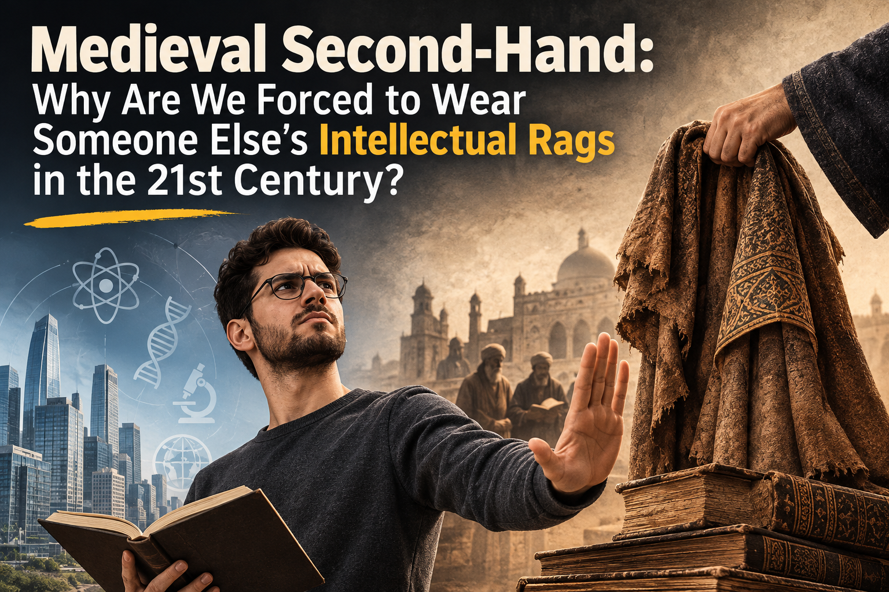

# Средневековый секонд-хенд: почему нас заставляют носить чужие ментальные лохмотья в XXI веке?

*Почему человек, живущий в эпоху современной науки, медицины, технологий и практически неограниченного доступа к информации, должен выстраивать свою религиозную жизнь по интерпретациям учёных, умерших тысячу лет назад? И в какой момент уважение к прошлому превратилось в обязанность оставаться его интеллектуальным пленником?*

---

## 1. Тысяча лет спустя нам всё ещё объясняют, как думать

Представьте, что современная медицина официально обязала бы врачей лечить пациентов исключительно по учебникам X века. Любая попытка использовать новые исследования считалась бы не развитием науки, а проявлением неуважения к древним авторитетам.

Звучит абсурдно? Именно так выглядит отношение к значительной части современного религиозного права.

Мусульманину предлагают жить в XXI веке, пользоваться современной медициной, банковскими системами, транспортом, интернетом и технологиями, но при этом принимать религиозные решения через интеллектуальные конструкции, сформировавшиеся в совершенно других социальных, политических и научных условиях.

Причём сомнение в этих конструкциях нередко воспринимается почти как сомнение в самой религии.

Но с чего вообще взялось это обязательство?

Почему мнения людей, живших много веков назад, получили статус практически неприкосновенных ориентиров для миллионов людей, которые никогда не встречались с ними, не знают условий их жизни и зачастую даже не могут самостоятельно проверить основания их выводов?

---

## 2. Как человеческие интерпретации превратились в систему авторитета

Коран появился в VII веке. Однако значительная часть исламского права в его последующем систематизированном виде формировалась уже после смерти Мухаммада.

В течение последующих столетий развивались правовые методы, собирались и классифицировались предания, создавались юридические трактаты, формировались школы и системы передачи знаний.

Это был исторический процесс, а не одномоментное получение готового правового кодекса.

Учёные не просто переписывали текст Корана. Они выстраивали методы, с помощью которых определяли, какие источники считать юридически значимыми, как разрешать противоречия между ними, как выводить нормы и как применять их к новым обстоятельствам.

Одним из важнейших этапов стало развитие правовых школ — *мазхабов*. Постепенно вокруг них сформировались устойчивые интеллектуальные традиции: собственные труды, методологии, цепочки преподавания, авторитетные комментарии и механизмы подготовки юристов.

История шафиитской школы, исследованная Ахмедом Эль-Шамси, показывает, как личные учения и юридические методы постепенно превращались в организованную правовую традицию.

Именно здесь произошёл принципиальный сдвиг: религиозное право стало существовать не только как обращение к откровению, но и как сложная система человеческих интерпретаций, воспроизводимая через признанные школы и их авторитеты.

Сама по себе систематизация знаний не является проблемой. Проблема начинается тогда, когда исторически сформированную систему начинают выдавать за окончательную границу допустимого мышления.

---

## 3. Закрытие дверей иджтихада: миф о закончившейся истории

В популярном изложении истории исламского права часто встречается утверждение, что примерно к X–XI векам «двери *иджтихада* закрылись».

Обычно это представляют как момент, после которого независимое юридическое мышление якобы уступило место следованию уже сформированным школам.

Историческая картина сложнее. Не существовало единого документа или общеисламского решения, которым все учёные однажды объявили бы самостоятельное правовое рассуждение запрещённым. Исследователи, включая Ваэля Халляка, показали, что привычный рассказ о полном и окончательном закрытии *иджтихада* не соответствует реальной истории.

Но отсутствие единственного указа не отменяет главного: правовые школы постепенно укрепляли свои позиции, а следование признанным авторитетам становилось важнейшей частью юридической практики.

Правовое мышление всё чаще развивалось внутри уже существующих методологических рамок. Учёный мог рассуждать, сопоставлять мнения, делать выводы — но его работа обычно оценивалась через признанные категории и авторитеты традиции.

Так формировалась интеллектуальная иерархия, в которой одни мнения получали статус канонических, другие считались допустимыми лишь в определённых пределах, а самостоятельный выход за установленные рамки мог восприниматься как угроза самой системе.

История не остановилась. Остановить попытались право человека самостоятельно пересматривать её результаты.

---

## 4. Как система научилась воспроизводить себя

Устойчивость религиозного авторитета объясняется не только убедительностью отдельных аргументов. Она обеспечивается институтами.

Правовые школы передавали знания через преподавателей, учебные программы, комментарии и признанные тексты. Религиозное образование формировало специалистов, которые осваивали уже существующие методы и классификации. Судебные и административные структуры в разных исторических обществах использовали правовые школы как источник юридических кадров и практических решений.

Власть получала подготовленных специалистов и понятную систему правовых норм. Учёные получали общественное признание, должности и возможность влиять на правовую жизнь. Общество получало привычную структуру религиозного авторитета.

Это не означает, что существовал единый заговор правителей и богословов. Для воспроизводства системы заговор вообще не нужен. Достаточно того, чтобы её участники были заинтересованы в сохранении привычных правил и чтобы альтернативные подходы не имели сопоставимой институциональной поддержки.

Так работает любая устойчивая система власти: она превращает собственные исторические достижения в условия собственного дальнейшего существования.

И со временем вопрос «насколько это верно?» уступает место вопросу «насколько это соответствует признанной традиции?».

---

## 5. Почему человек сам отдаёт кому-то право думать за него

Было бы слишком просто обвинить во всём только религиозные институты.

Система авторитета существует не в пустоте. Она отвечает на вполне человеческий запрос.

Самостоятельное мышление требует усилий. Нужно читать, сопоставлять источники, признавать собственные ошибки, выдерживать неопределённость и принимать ответственность за выводы.

Гораздо удобнее получить готовый ответ от человека, которого называют учёным.

Не нужно разбираться в контексте. Не нужно изучать язык. Не нужно сопоставлять аяты. Не нужно проверять, действительно ли приведённое основание подтверждает сделанный вывод.

Достаточно спросить: «Что говорят учёные?»

Так возникает зависимость, в которой человек постепенно перестаёт воспринимать собственное мышление как необходимую часть религиозной жизни.

Психология давно изучает механизмы, которые помогают объяснить подобное поведение.

* **Подчинение авторитету.** Люди склонны принимать решения признанных специалистов даже тогда, когда не способны самостоятельно оценить их основания.
* **Конформизм.** Человек может предпочесть мнение большинства собственному анализу, особенно если несогласие грозит социальной изоляцией.
* **Когнитивный диссонанс.** Чем больше времени, усилий и эмоциональных ресурсов вложено в определённую систему убеждений, тем болезненнее бывает признать её ошибки.
* **Эффект невозвратных затрат.** Человек продолжает защищать прежний выбор не потому, что он по-прежнему обоснован, а потому, что слишком многое уже вложено в его принятие.

В религиозной среде эти механизмы могут усиливаться страхом ошибиться перед Аллахом, потерять принадлежность к общине или оказаться за пределами того, что считается правильной верой.

В результате человек начинает защищать не только конкретное мнение, но и саму систему, которая освободила его от необходимости постоянно проверять собственные убеждения.

И самое интересное: система уже не обязана заставлять его молчать. Он сам начинает следить за тем, чтобы не задавать лишних вопросов.

---

## 6. Сложность превратили в монополию

Исламское право действительно накопило огромный массив литературы. Там есть сложные дискуссии, терминология, классификации и многовековые разногласия.

Но сложность предмета не даёт никому права на монополию над ним.

Знание арабского языка не делает человека непогрешимым. Статус преподавателя не превращает его выводы в откровение. Длинная цепочка учителей не гарантирует истинность передаваемого мнения.

И уж точно возраст книги не является доказательством её правоты.

Здесь возникает удобная подмена: вместо того чтобы объяснить, почему конкретный вывод верен, человеку сообщают, что он не обладает достаточной квалификацией, чтобы вообще его обсуждать.

Разумеется, специалист может знать больше неспециалиста. Это относится к любой области знаний. Но компетентность — основание выслушать аргумент, а не основание освободить его от проверки.

Если утверждение касается религиозной обязанности, вопрос об основании остаётся обязательным независимо от того, кто его произнёс.

---

## 7. Почему религия должна быть освобождена от интеллектуального развития?

Современный человек располагает инструментами, которых не было у средневековых учёных: огромными цифровыми корпусами текстов, сравнительным языкознанием, археологией, исторической критикой, новыми методами исследования рукописей и доступом к научным публикациям со всего мира.

Это не означает, что современный человек автоматически умнее любого учёного прошлого. Это означает, что у него есть дополнительные средства для проверки утверждений.

Но почему их использование в религиозных вопросах иногда воспринимается как угроза?

Потому что развитие знаний неизбежно ставит под сомнение прежние объяснения. А система, построенная на авторитете закреплённых интерпретаций, не всегда заинтересована в пересмотре собственных оснований.

Вместо обсуждения аргументов появляется привычный набор обвинений: высокомерие, невежество, самоуверенность, отсутствие уважения к учёным.

Это особенно показательно. Если мнение действительно обосновано, его можно защитить аргументами. Если единственная защита — запрет на вопросы, перед нами уже не доказательство, а охрана авторитета.

---

## 8. Даже Коран призывает смотреть, исследовать и думать

В Коране неоднократно звучит призыв наблюдать, размышлять и использовать разум.

> «Скажи: странствуйте по земле и посмотрите, как Он начал творение» (29:20).
>
> «Не следуй тому, о чём у тебя нет знания» (17:36).
>
> «Скажи: разве равны те, которые знают, и те, которые не знают?» (39:9).

Эти обращения не похожи на приглашение передать собственное мышление в бессрочное управление людям прошлого.

Особенно показателен аят 16:43, где людям предлагается обращаться к тем, кто обладает знанием, если они сами не знают.

Но обращение за информацией и передача кому-то окончательного права определять истину — совершенно разные вещи.

Можно спросить специалиста. Можно изучить его объяснение. Можно использовать его опыт. Но из этого не следует, что его мнение становится неприкосновенным или что последующие поколения обязаны отказаться от проверки.

Коран не превращает человеческую учёность в отдельный источник откровения.

---

## 9. Когда старое знание начинают выдавать за вечную истину

Рассмотрим простой пример.

В средневековом мире учёные работали с ограниченным набором инструментов наблюдения и исследования. Они объясняли окружающий мир в рамках доступных им знаний.

Сегодня мы располагаем совершенно иными возможностями.

Даже человеческий мозг, который когда-то описывали через наблюдаемые анатомические структуры и общие представления о мышлении, теперь изучается с помощью нейровизуализации, экспериментальной психологии и нейробиологии.

Можно вспомнить аяты 96:15–16, где говорится о *на̄сия* — передней части головы, за которую хватают человека, и характеризуют её как лживую и грешную.

Некоторые современные авторы пытаются связать это описание с префронтальной корой и объявляют его научным предсказанием.

Однако сам текст не называет префронтальную кору, а современные исследования не подтверждают существование единственного участка мозга, отвечающего за ложь. Научные работы изучают участие префронтальных областей в исполнительных функциях и процессах обмана, но это не даёт оснований превращать аят в нейробиологическую схему.

И здесь важен другой вывод: не нужно приписывать древнему тексту современные научные термины, чтобы признать ценность исследования. Не нужно и объявлять средневековое толкование последней инстанцией только потому, что оно старше.

Если новые знания позволяют лучше понять человеческое тело, язык или историю, их следует использовать. В этом нет предательства религии. Это обычная работа с реальностью.

---

## 10. Почему пересмотр средневековых мнений воспринимается как угроза

Потому что на кону не только содержание отдельных религиозных предписаний.

На кону сама структура авторитета.

Если человек может самостоятельно прочитать Коран, сопоставить его аяты, изучить язык и проверить выводы средневекового юриста, то возникает неудобный вопрос: зачем ему считать мнение этого юриста обязательным?

Если он может обнаружить противоречие между утверждением современного проповедника и текстом, на каком основании он должен предпочесть проповедника?

Если авторитет учёного больше не освобождает его слова от проверки, меняется положение самого учёного.

Именно поэтому критика конкретного мнения часто воспринимается как нападение на религию, а требование доказательств — как проявление высокомерия.

Но здесь стоит разделить две вещи, которые слишком часто намеренно смешивают:

**уважение к знаниям прошлого и подчинение знаниям прошлого.**

Первое разумно. Второе требует отдельного обоснования.

Можно уважать учёного X века, изучать его труды, понимать его эпоху и признавать его вклад. Но почему человек XXI века должен считать его выводы обязательными для себя? Где именно установлено, что историческая дата публикации превращает человеческое мнение в вечную норму?

Ссылка на авторитет не отвечает на этот вопрос.

---

## 11. Прошлое — источник, а не тюрьма

Средневековые учёные жили в других обществах, располагали другими знаниями и решали задачи своего времени. Их труды — важная часть интеллектуальной истории. Их можно изучать, критиковать, использовать и пересматривать.

Но они не являются продолжением откровения.

Их мнения не становятся божественными только потому, что вокруг них сформировалась школа, а школа просуществовала несколько столетий.

Самое парадоксальное в этой истории заключается в том, что люди, которые сегодня требуют от нас безусловного уважения к средневековым авторитетам, сами пользуются результатами интеллектуальной работы поколений, которые не боялись развивать и пересматривать правовые методы своих предшественников.

Те, кто когда-то пересматривал мнения предшественников, теперь требуют, чтобы мы не пересматривали их собственные.

Это не защита религии. Это защита наследуемой системы авторитета.

Коран не является средневековой рукописью, которой требуется постоянный надзор средневековых комментаторов. А человеческая учёность не является откровением.

> **X век — это история. Не предписание для XXI века.**

---

## Источники и литература

1. **El Shamsy, Ahmed.** *From Tradition to Law: The Origins and Early Development of the Shafi'i School of Law in Ninth-Century Egypt.* Oxford University Press, 2013.
2. **Hallaq, Wael B.** “Was the Gate of Ijtihad Closed?” *International Journal of Middle East Studies*, Vol. 16, No. 1, 1984, pp. 3–41.
3. **Emon, Anver M.** “Ijtihad.” In: *The Oxford Handbook of Islamic Law*, 2015.
4. **Vikør, Knut S.** “Early Islamic Law until 1500.” *Oxford Bibliographies in Islamic Studies*, 2026.
5. **Ibrahim, Ahmed Fekry.** “Rethinking the Taqlid Hegemony: An Analysis of Four Legal Statements.”
6. **Christ, Shawn E., et al.** “The Contributions of Prefrontal Cortex and Executive Control to Deception.” *Cerebral Cortex*, Vol. 19, No. 7, 2009, pp. 1557–1566.
7. **Коран:** 16:43; 17:36; 29:20; 39:9; 96:15–16.
8. **Ат-Табари.** *Толкование Корана*, комментарий к 96:15–16.
