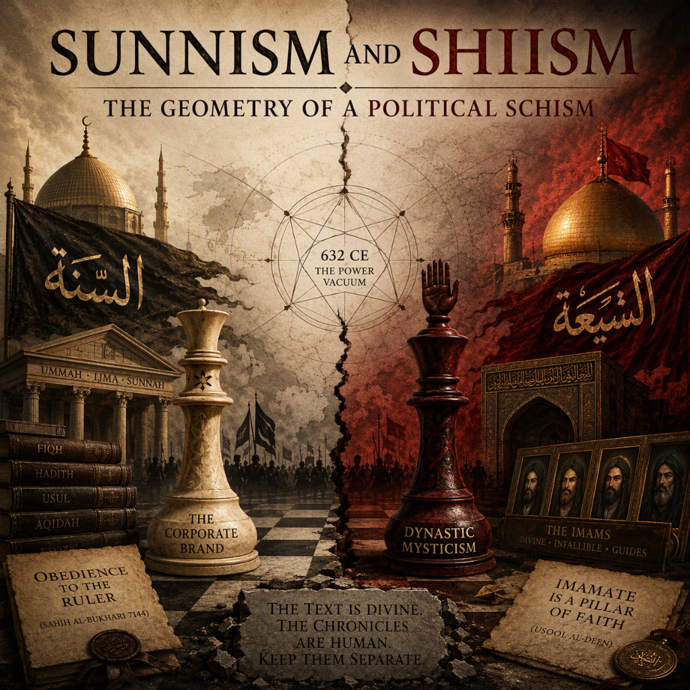

# От политических фракций к теологическим догматам: постпророческое формирование суннизма и шиизма

> **Аннотация.** Суннизм и шиизм часто представляют так, будто они возникли сразу после смерти Мухаммада как две чётко определённые религиозные позиции, каждая из которых сохраняла собственное понимание руководства, санкционированного Богом. Другая форма редукционизма объясняет весь раскол исключительно борьбой за власть. Ни один из этих подходов не отражает исторический процесс в полной мере. Разделение формировалось на протяжении столетий: споры о преемственности, политической легитимности, единстве общины и религиозном авторитете постепенно приобретали теологическую форму. Ранние сторонники Али ещё не составляли того двунадесятнического шиизма, который сформировался в последующие века, подобно тому как политическая общность, поддерживавшая первых халифов, ещё не представляла собой институционализированную суннитскую ортодоксию в её современном виде. Эта история показывает, как политические конфликты после завершения пророческой миссии превратились в устойчивые системы религиозного авторитета — и как последующие поколения истолковывали эти конфликты через доктрины, которых их первоначальные участники необязательно придерживались.

---

## 1. Кризис преемственности: Сакыфа и политика легитимности

Смерть Мухаммада в 632 году поставила общину перед проблемой, для решения которой Коран не предусматривал подробной конституционной процедуры: кто должен осуществлять политическое руководство общиной после завершения пророческого откровения?

Собрание в Сакыфе Бану Саида стало ключевым эпизодом в решении этого вопроса. Пока ансары — мусульмане Медины — обсуждали руководство общиной между собой, к переговорам присоединились Абу Бакр, Умар ибн аль-Хаттаб и другие переселенцы из Мекки. Итогом стало принесение присяги Абу Бакру, положившее начало первому халифату.

Это было не собрание, на котором представители всех группировок объединились, чтобы применить согласованную конституционную систему. Это были срочные политические переговоры, проходившие в условиях неопределённости относительно будущего общины.

### Конкурирующие притязания на руководство

В споре переплетались три группы интересов:

* **Ансары.** Предоставив общине опору в Медине, они имели собственные основания претендовать на значимую роль в её дальнейшем руководстве. Их позиция отражала как вклад в движение, так и обеспокоенность тем, кто будет контролировать формирующийся политический порядок.
* **Мухаджиры.** Абу Бакр и его сторонники подчёркивали положение курайшитов — племени Мухаммада — и необходимость лидера, чья власть могла бы получить признание в разных арабских племенных сообществах. Политическая роль курайшитов впоследствии неоднократно становилась аргументом в дискуссиях о легитимности правления.
* **Семья Пророка.** Али ибн Абу Талиб и другие представители Бану Хашим занимали особое положение благодаря родству с Мухаммадом. Их последующие притязания стали центральными для формировавшегося шиитского понимания легитимного руководства.

Это не были три полностью организованные партии с неизменными программами. Скорее, речь идёт о конкурирующих интересах и аргументах, реконструируемых по более поздним повествованиям, авторы которых писали уже после того, как эти конфликты приобрели религиозное значение.

Вопрос о преемственности также не решался посредством консультации, в которой участвовали бы все представители общины. Али и ряд членов семьи Мухаммада не участвовали в первоначальном принятии решения в Сакыфе. Скорость и ограниченный состав участников впоследствии стали важными аргументами в спорах о легитимности избрания Абу Бакра.

В своей книге *The Succession to Muhammad* («Преемственность после Мухаммада») Уилферд Маделунг рассматривает ранний халифат именно через конфликт вокруг руководства общиной, включая конкурирующие притязания курайшитов и хашимитской семьи Пророка.

Суть не в том, что Сакыфу можно свести к тайному заговору. Суть в том, что первого халифа избрали в ходе человеческого политического процесса, а не посредством процедуры, прямо установленной Кораном.

### Что установил Коран?

Коран содержит принципы, имеющие отношение к руководству: совещание (42:38), справедливость (4:58; 4:135), а также повиновение Богу, посланнику и тем, кому доверена власть (4:59). Однако он не предлагает законченной конституционной модели, которая предусматривала бы халифат, процедуру передачи власти или наследственную линию правителей.

Коран также не устанавливает прямо, что политическое руководство должно принадлежать исключительно курайшитам или потомкам Мухаммада.

Подобные утверждения пришлось обосновывать, толковать и развивать в рамках политического и религиозного дискурса, возникшего после завершения пророческой миссии. Позднейшие традиции предложили разные ответы на вопрос, для которого Коран не устанавливал однозначной институциональной процедуры.

Таким образом, первое крупное разделение касалось не только личных предпочтений. Оно поставило вопрос, остававшийся нерешённым на протяжении столетий: что делает правителя легитимным, если после завершения пророческого откровения уже нет живого авторитета, способного окончательно разрешить спор?

---

## 2. От спора о преемственности к гражданской войне: первая фитна

Первоначальный спор о преемственности не привёл немедленно к возникновению двух полностью сформировавшихся религиозных направлений. Несмотря на разногласия по поводу руководства, ранняя община сохраняла политические связи. Однако расширение государства, распределение завоёванных богатств и усиление провинциальных элит создавали новые противоречия.

Особенно заметными эти процессы стали во время правления Усмана ибн Аффана (644–656 годы).

### Управление, покровительство и распределение власти

Правительство Усмана столкнулось с растущим недовольством по поводу управления провинциями, назначения наместников и влияния его родственников из рода Омейядов. Критики обвиняли администрацию в фаворитизме и концентрации власти в руках узкого круга приближённых.

Эти претензии не сводились исключительно к богословским разногласиям. Речь шла о том, кто контролировал назначения, доходы, военные ресурсы и политические преимущества, возникавшие благодаря завоеваниям.

Это различие принципиально важно. Позднейшие повествования нередко интерпретируют ранние конфликты через уже сложившиеся религиозные категории. Однако их участники действовали и в рамках стремительно расширявшейся имперской системы. Племенная лояльность, местное соперничество, материальные интересы и аргументы о справедливости могли переплетаться, не становясь при этом одним и тем же явлением.

Усман был убит в 656 году. После этого халифом стал Али, однако его восшествие на престол не восстановило согласие.

Муавия ибн Абу Суфьян, наместник Сирии и родственник Усмана, потребовал привлечь к ответственности убийц халифа и отказался признавать власть Али на предложенных им условиях. Спор перерос в вооружённое противостояние.

### Сиффин и пределы политического единства

В битве при Сиффине в 657 году войска Али столкнулись с армией Муавии. В позднейших исторических повествованиях широко известен эпизод, в котором сторонники Муавии якобы подняли на копьях страницы Корана и призвали к арбитражу.

Этот эпизод стал мощным символом в коллективной памяти о конфликте. Конкретные детали зависят от более поздних переданных повествований, но историческое значение происходившего очевидно: борьба за политическую власть оказалась тесно связана со спорами о том, кто вправе толковать и осуществлять Божий суд.

Арбитраж расколол сторонников Али. Группа, получившая название хариджитов, отвергла соглашение и заняла более бескомпромиссную позицию по вопросам легитимного руководства и тяжкого греха. Их последующее восстание показало, что конфликт уже не ограничивался противостоянием Али и Муавии. Различные мусульманские группировки начали формулировать собственные критерии политической и религиозной легитимности.

Это был важный переходный этап. Политические споры всё чаще требовали ответов на богословские вопросы: можно ли повиноваться несправедливому правителю? Лишает ли тяжкий грех человека права руководить? Важнее ли единство общины, чем сопротивление несправедливости? Кто уполномочен принимать такие решения?

Первая фитна не создала мгновенно позднейший суннитско-шиитский раскол, но способствовала формированию конфликтов, из которых впоследствии выросли отдельные политические и теологические традиции.

На этом раннем этапе верность Али ещё не означала принятия всех доктрин, которые впоследствии стали ассоциироваться с шиизмом. Точно так же поддержка первых халифов не предполагала принадлежности к уже завершённому суннитскому вероучению.

Нельзя переносить названия позднейших традиций в прошлое так, словно их окончательные границы существовали с самого начала.

---

## 3. Кербела: поражение, память и преобразование авторитета

В 680 году Хусейн ибн Али, внук Мухаммада, был убит вместе с небольшой группой родственников и сторонников при Кербеле во время столкновения с силами, верными омейядскому халифу Язиду I.

Убийство Хусейна стало одним из определяющих событий шиитской исторической памяти. Однако его значение нельзя понять, если считать Кербелу моментом, когда внезапно возникла законченная шиитская теология.

Политическое движение, связанное с семьёй Пророка, существовало ещё до гибели Хусейна. Кербела изменила символическую и эмоциональную силу этого движения.

### От притязания на власть к языку мученичества

Гибель Хусейна превратила конфликт между Омейядским государством и семьёй Пророка в устойчивое нравственное повествование. Неудавшееся политическое выступление стало восприниматься как противостояние законного морального авторитета и несправедливой власти.

Со временем память о Кербеле заняла центральное место в шиитской общинной идентичности. Поминовение, паломничество, траурные обряды и повествования о мученичестве помогали сохранять коллективную память об исключении и преследовании. Эти практики не просто увековечивали событие: они способствовали формированию отдельной общности, передаче её исторического самосознания и укреплению представлений о связи страдания с легитимной властью.

Святилище в Кербеле сравнительно рано стало местом паломничества, тогда как институционализация памятных обрядов развивалась на протяжении последующих столетий. Это был постепенный исторический процесс, а не одномоментное преобразование.

Однако одного мученичества было недостаточно для формирования завершённой доктрины имамата. Она складывалась в ходе дальнейших споров о преемственности внутри семьи Пророка, личности законных имамов и природе их авторитета.

### Постепенное формирование имамата

Различные шиитские движения предлагали разные ответы на эти вопросы. Зейдизм, исмаилизм и двунадесятнический шиизм развивались по разным историческим траекториям и не разделяют все доктрины, сложившиеся в позднейшие эпохи.

В двунадесятническом шиизме доктрина имамата со временем стала включать представления о божественном назначении имама (*насс*), его особой защищённости от религиозной ошибки (*исма*) и авторитетном знании, связанном с его положением.

Эти доктрины нельзя просто перенести в прошлое и приписать самым ранним сторонникам Али так, будто они всегда существовали в своей позднейшей форме. Они развивались, обсуждались и систематизировались в условиях меняющихся политических обстоятельств и последовательных кризисов руководства.

Учение о Сокрытом имаме особенно наглядно демонстрирует этот процесс. После смерти одиннадцатого имама Хасана аль-Аскари в 874 году вопрос о его преемнике вызвал серьёзный кризис в имамитской общине. В двунадесятническом учении утвердилось представление о том, что у него был сын Мухаммад ибн аль-Хасан, который ушёл в сокрытие и однажды должен вернуться. Однако ранние имамитские источники фиксируют разногласия относительно личности и даже существования преемника. Это показывает, что впоследствии утвердившееся учение изначально не принималось всеми без споров.

Доктрина сокрытия относится к более позднему этапу религиозного развития, а не к первоначальному спору в Сакыфе.

Здесь принципиально важно различать два утверждения: политическое притязание на то, что семья Пророка заслуживала руководства, и теологическое утверждение, что определённая линия имамов обладала защищённым Богом авторитетом, связаны между собой, но не являются одним и тем же историческим тезисом.

Первое не может автоматически служить доказательством второго.

---

## 4. Формирование суннизма: община, традиция и политический порядок

Если шиизм развивался в том числе через конкурирующие притязания на особый авторитет семьи Пророка, то традиция, из которой сформировался суннизм, складывалась вокруг другого круга вопросов: сохранения преемственности общины, авторитета унаследованной практики, толкования передаваемых сообщений и опасности повторяющихся гражданских войн.

Однако суннизм не был учреждён одним решением единственного халифа или одной династии. Его формирование представляло собой длительный процесс, в котором участвовали правители, учёные, передатчики преданий, правоведы и представители конкурирующих интеллектуальных школ.

### Политика единства общины

Периоды правления Омейядов и Аббасидов были отмечены восстаниями, династическим соперничеством и спорами о легитимности правителей. В этих условиях сохранение единства общины становилось всё более значимым аргументом в мусульманской политической мысли.

Некоторые учёные и передатчики подчёркивали опасность восстаний и необходимость избегать новой гражданской войны даже при правителях, которых считали несправедливыми. Со временем эта тенденция приобрела значительное влияние в суннитской политической мысли.

У такого аргумента была практическая привлекательность: после десятилетий внутренних конфликтов новое восстание могло привести к гибели людей и дестабилизации общины. Однако тот же принцип мог ограничивать сопротивление политической несправедливости и обеспечивать религиозное оправдание правителям, обладавшим реальной властью, но не обязательно моральной легитимностью.

Это противоречие заметно в исторических источниках. Доктрина, препятствующая восстаниям, в одних обстоятельствах может уменьшать кровопролитие, а в других — защищать укоренившуюся власть.

Впрочем, было бы ошибкой предполагать, что все учёные просто исполняли волю государства. Мусульманские учёные могли служить при дворе, получать покровительство, вести переговоры с правителями, критиковать их или сопротивляться государственным требованиям. Отношения между религиозным авторитетом и политической властью были предметом борьбы, а не единообразной системой подчинения.

### От сунны к суннитской идентичности

Слово *сунна* изначально не было названием одной полностью сформировавшейся конфессии. Оно обозначало нормативный прецедент и практику, а авторитет примера Мухаммада постепенно приобретал всё большее значение в религиозных спорах.

Со временем приверженность сунне стала связываться с более широкой идентичностью, основанной на унаследованной традиции и *джамаа* — общине или коллективном сообществе мусульман. Исследования позднеомейядского и раннеаббасидского периодов прослеживают развитие представлений о приверженности общине и формировании протосуннитской идентичности через сети передатчиков и учёных.

Поэтому выражение *ахль ас-сунна ва-ль-джамаа* не следует воспринимать как название полностью институционализированной ортодоксии, уже существовавшей в 632 году. Эта идентичность и её доктринальные границы формировались постепенно.

Аналогичный процесс происходил при становлении суннитских правовых и теологических традиций. Учёные, впоследствии ставшие авторитетными фигурами этих традиций, жили в эпоху споров о праве, Писании, разуме, передаваемых сообщениях и природе религиозного авторитета. Сложившийся в итоге суннитский консенсус не был просто указом правителя: он формировался в ходе длительных процессов отбора, дискуссий, обучения и институционального признания.

### Хадисы и авторитет унаследованных сообщений

Собирание и оценка хадисов стали центральными элементами развития исламского права и теологии. Сообщения, приписываемые Мухаммаду и ранней мусульманской общине, использовались для уточнения ритуальной практики, установления правовых норм, определения религиозных обязанностей и обоснования представлений о руководстве и повиновении.

Основные суннитские сборники хадисов приобрели канонический статус в ходе процессов, продолжавшихся несколько поколений. Их появление нельзя свести к единому проекту, организованному государством, а исторические обстоятельства возникновения отдельных сообщений необходимо исследовать в каждом конкретном случае.

Тем не менее политические последствия были значительными. Когда сообщение, приписываемое Пророку, признавалось авторитетным, оно могло не просто описывать прошлое, но и устанавливать нормативное требование для настоящего. Аргументы о легитимности правителей, опасности восстаний, авторитете курайшитов и обязанности сохранять единство общины могли приобретать дополнительный вес, если представлялись как пророческий прецедент.

Это не доказывает, что правители заказывали каждое удобное им сообщение или что каждый хадис был сфабрикован в политических интересах. Речь о другом: приписывание авторитета Пророку стало одним из важнейших механизмов, посредством которых последующие поколения определяли религиозные и политические нормы.

Различие между историческим происхождением и последующим авторитетом здесь принципиально. Сообщение может стать основополагающим для религиозной традиции, даже если обстоятельства его возникновения, передачи или толкования по-прежнему открыты для исторического исследования.

---

## 5. Две традиции — два разных ответа на проблему авторитета

К тому времени, когда основные суннитские и шиитские традиции приобрели более узнаваемые формы, они выработали разные ответы на общую проблему постпророческой эпохи: где находится обязательный для верующих религиозный авторитет после смерти человека, передавшего откровение?

В общих чертах суннитские традиции стали подчёркивать Коран, сунну Пророка, передаваемую и толкуемую посредством признанных учёных методов, а также авторитет унаследованной религиозной традиции общины. Шиитские традиции придавали особое значение авторитету имамов из семьи Пророка, хотя конкретное понимание этого авторитета различалось между шиитскими направлениями.

Это не просто абстрактные богословские различия. Это разные решения исторического кризиса преемственности и авторитета.

В одном случае центральное место в религиозной легитимности заняли непрерывность общины и унаследованная учёная традиция. В другом представление о том, что законная власть принадлежит семье Пророка, развилось в доктрину имамата, причём некоторые направления со временем стали приписывать имаму уникальный, защищённый от ошибок и установленный Богом статус.

Ни одна из этих систем не существовала в завершённом виде в момент смерти Мухаммада. Обе формировались под влиянием последующих конфликтов, дискуссий, институтов и интерпретаций.

При этом ни одну из традиций не следует считать политически однородной. Суннитские правители и учёные расходились во взглядах; шиитские движения оспаривали друг у друга представления о преемственности и вероучении; политические деятели неоднократно использовали религиозный язык для обоснования конкурирующих притязаний.

Исторический вопрос состоит не в том, была ли каждая позднейшая доктрина цинично изобретена. Важно понять, как определённые утверждения приобретали авторитет, почему одни интерпретации побеждали другие и как общины начинали воспринимать исторически сформировавшиеся позиции как обязательные религиозные истины.

---

## Заключение: завершение пророчества не завершило борьбу за власть от имени откровения

История суннизма и шиизма показывает, что завершение пророческого откровения не прекратило споров о религиозном авторитете. Оно изменило их характер.

Кризис преемственности 632 года поставил нерешённые вопросы о руководстве. Первая фитна превратила их в гражданскую войну. Кербела преобразовала память о политическом поражении в центральное повествование о мученичестве и несправедливости. Последующие поколения разработали различные теории легитимного руководства, религиозного знания, единства общины и авторитета передаваемой традиции.

Эти процессы продолжались столетиями. На них влияли искренние богословские размышления, политические расчёты, общественные обстоятельства, институциональные интересы и конкурирующие интерпретации унаследованных источников. Ни один отдельный фактор не объясняет всего происходившего.

Однако одно различие остаётся принципиальным: историческое формирование доктрины и её последующая претензия на божественный авторитет — это два разных вопроса.

Установить, что община со временем признала имама назначенным Богом или определённую унаследованную традицию авторитетной, ещё не значит доказать, что первоначальное откровение прямо предписывало такой порядок. Историческое влияние не доказывает божественного установления, так же как политическая полезность сама по себе не доказывает фабрикации.

Коран не предложил подробного конституционного механизма передачи власти после смерти Мухаммада. Институты и доктрины, которые впоследствии заполнили это пространство, формировались под воздействием человеческих решений и исторических обстоятельств. Поэтому их позднейший религиозный авторитет необходимо исследовать, а не принимать как данность.

Суннизм и шиизм — не просто два неизменных лагеря, полностью сформировавшихся в ранней мусульманской общине. Это исторические традиции, чьи идентичности складывались, оспаривались и закреплялись уже после завершения пророческой миссии.

Пророческая миссия завершилась. Борьба за право авторитетно говорить от её имени продолжилась.

---

## Первичные источники и дальнейшая литература

### Ранние исторические источники и переданные сообщения

1. **Ат-Табари.** *The History of al-Tabari (Ta'rikh al-Rusul wa al-Muluk)*. Соответствующие переведённые тома охватывают ранний халифат, убийство Усмана, первую фитну и события, приведшие к Кербеле.
2. **Ибн Саад.** *Kitab al-Tabaqat al-Kabir*. Биографические материалы о Мухаммаде, его семье и ранней мусульманской общине.
3. **Сахих аль-Бухари и Сахих Муслим.** Более поздние канонические сборники хадисов, полезные для изучения того, как передавались и канонизировались сообщения о руководстве, единстве общины и религиозном авторитете.

Эти труды являются незаменимыми историческими источниками, однако они не представляют собой современные описываемым событиям стенограммы каждого эпизода. Их повествования необходимо сопоставлять друг с другом и оценивать с учётом истории передачи сообщений и литературного контекста.

### Академическая литература

1. **Madelung, Wilferd.** *The Succession to Muhammad: A Study of the Early Caliphate*. Cambridge University Press, 1997. Важное исследование спора о преемственности и конкурирующих притязаний первых халифов и семьи Пророка.
2. **Donner, Fred M.** *Muhammad and the Believers: At the Origins of Islam*. Harvard University Press, 2010. Исследование раннего движения и формирования общины вокруг Мухаммада.
3. **Crone, Patricia.** *Medieval Islamic Political Thought*. Edinburgh University Press, 2014. Широкое исследование ранней мусульманской политической мысли, гражданских конфликтов, формирования религиозных направлений и развития теорий правления.
4. **Jafri, S. H. M.** *The Origins and Early Development of Shi'a Islam*. Longman, 1979. Историческое исследование раннего движения сторонников Али и формирования шиитской идентичности.
5. **Arjomand, Said Amir.** “The Crisis of the Imamate and the Institution of Occultation in Twelver Shi'ism: A Sociohistorical Perspective.” *International Journal of Middle East Studies* 28, no. 4 (1996): 491–515. Исследование исторических кризисов вокруг имамата и формирования учения о сокрытии.
6. **Barzegar, Abbas.** “‘Adhering to the Community’ (*Luzūm al-Jamāʿa*): Continuities between Late Umayyad Political Discourse and ‘Proto-Sunni’ Identity.” *Review of Middle East Studies* 49, no. 2 (2015): 140–158. Исследование формирования представлений об общине в ранней суннитской мысли.
7. **Asi, Marjan.** *Obeying the (Unjust) Ruler: Tracing a Political Ideology in the Hadith Corpus*. PhD thesis, University of Edinburgh, 2022. Анализ передачи и исторического развития сообщений о повиновении правителям.
