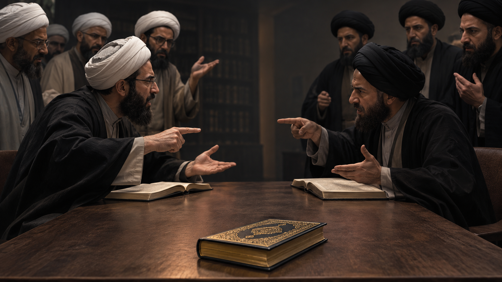

# Знамение в природе Его творения: как Аллах сохранил Коран

*Помимо рукописей и заучивания наизусть: как сама человеческая природа могла стать частью защиты божественного откровения.*

---

## Введение: обещание и исторический вопрос

Коран содержит примечательное утверждение:

> «Воистину, Мы ниспослали Напоминание, и воистину, Мы его оберегаем».
>
> *15:9*

Это не просто обещание о книге. Оно ставит исторический вопрос: каким образом откровение, переданное в определённом месте, на определённом языке и определённой общине, смогло пережить столетия политических потрясений, войн, соперничества, смены правителей, конкурирующих религиозных движений и амбиций бесчисленного множества людей?

Бумага ветшает. Пергамент может сгореть. Библиотеки могут исчезнуть. Государства рушатся. Люди умирают. Даже те, кто выучил весь текст наизусть, могут быть убиты.

И всё же Коран сохранился как узнаваемый и поразительно устойчивый текст на протяжении более чем четырнадцати столетий.

Мусульмане традиционно объясняют это сохранение божественной защитой, устной передачей, письменными рукописями и трудом ранних поколений. Это важные составляющие этой истории. Но есть и другое измерение, которое стоит рассмотреть — то, о котором в богословских объяснениях говорят редко.

Что если защита Корана Аллахом действовала и через саму природу людей?

Людьми движут не только искренность, смирение или преданность. Ими движут также гордость, соперничество, честолюбие, зависть, статус и желание доказать собственную правоту. Религиозная история полна этих склонностей.

И тем не менее, как ни парадоксально, именно эти человеческие слабости могли способствовать сохранению текста Корана.

Эту мысль стоит разобрать: Коран стал общей точкой отсчёта для конкурирующих групп, и даже те, кто расходился почти во всём остальном, имели веские причины защищать текст, придававший легитимность их собственной религиозной идентичности.

В защите откровения могли участвовать не только люди, которые искренне хотели его сберечь, но и те, чьи личные интересы делали его изменение крайне опасным.

---

## 1. Бумагу можно уничтожить. Человеческая память распределена

Начнём с очевидного.

Рукопись — это физический объект. Её можно уничтожить, потерять, повредить или намеренно изменить. Одна библиотека не может гарантировать выживание текста. Как и один правитель, один религиозный институт или одно поколение учёных.

Однако Коран сохранялся не через один-единственный физический экземпляр.

Его читали вслух, заучивали наизусть, записывали, преподавали, переписывали и передавали в разных общинах. Его текст существовал одновременно в нескольких формах: в рукописях, в памяти чтецов, в общественном богослужении, в учебных кружках и в повседневной религиозной жизни простых людей.

Это создавало своего рода распределённое сохранение.

Представьте попытку изменить отрывок в книге, которая существует только в одной царской библиотеке. Если правитель контролирует библиотеку, изменение может остаться незамеченным.

А теперь представьте попытку изменить отрывок, который заучен тысячами людей, читается в разных городах, переписывается независимыми писцами и используется в ежедневном богослужении.

Задача становится куда сложнее.

Человеку, пытающемуся внести изменение, пришлось бы преодолеть не один источник проверки, а множество независимых точек сверки.

Это важное различие. Сохранение не требует, чтобы каждый отдельный человек был искренним, а каждый институт — заслуживающим доверия. Оно требует достаточно широкой независимой передачи, чтобы расхождения можно было заметить и оспорить.

Место Корана в жизни мусульманской общины создавало именно такую избыточность.

Текст не просто хранился. Он непрерывно использовался.

---

## 2. Рукописи: что на самом деле сохранилось?

Сохранение Корана опирается не только на религиозные утверждения. Существует значительный массив сохранившихся рукописных свидетельств.

Несколько ранних рукописей имеют особое значение.

### Бирмингемская рукопись Корана

Эта рукопись, хранящаяся в коллекции Минганы при Бирмингемском университете, содержит фрагменты сур 18, 19 и 20, выполненные ранним хиджазским письмом. Радиоуглеродный анализ датирует пергамент 568–645 годами н. э. с вероятностью 95,4 %. Это датирует кожу животного, а не точный момент записи текста, но относит сам материал вплотную к первому исламскому столетию.

### Палимпсест из Саны

Одно из самых значимых открытий в области ранних коранических рукописей. В нём верхний текст соответствует стандартному *усмановскому* типу текста, а стёртый нижний текст содержит ряд текстовых отличий. Нижний текст особенно важен, поскольку даёт физическое свидетельство ранней вариативности текста.

### Парижско-Петербургский кодекс (*Codex Parisino-Petropolitanus*)

Ранняя рукопись Корана, обычно датируемая VII веком. Она особенно ценна для изучения ранних писцовых практик, орфографии, деления на аяты и передачи консонантного текста. Её сохранившиеся фрагменты находятся в нескольких собраниях, включая Париж, Санкт-Петербург и Ватикан.

### Тюбингенская рукопись Корана

Ещё один ранний рукописный фрагмент, пергамент которого по данным радиоуглеродного анализа относится к VII веку. Он даёт дополнительный материал для сопоставления ранних копий коранического текста.

Существуют также известные рукописи, связываемые с именем Усмана, в частности Самаркандский и Топкапы кодексы.

Однако их традиционное приписывание самому Усману не подтверждается современными рукописными исследованиями. Самаркандский кодекс, например, специалисты в основном датируют VIII или IX веком. Его историческую значимость не следует путать с доказательством того, что это личный экземпляр третьего халифа.

Это различие важно. Нам не нужно связывать имя Усмана с каждой знаменитой рукописью, чтобы признать ценность сохранившихся свидетельств.

Бирмингемская рукопись, палимпсест из Саны и другие ранние списки дают нечто более ценное, чем легенды: физический материал, который можно исследовать, сопоставлять и датировать.

Что показывают эти рукописи?

Подавляющая закономерность состоит в том, что ранние рукописи Корана принадлежат к тесно связанной текстовой традиции.

В примечательном исследовании, опубликованном в *Bulletin of the School of Oriental and African Studies* в 2019 году, Марейн ван Путтен изучил четырнадцать ранних рукописей Корана и выявил общие необычные орфографические особенности.

Его аргумент заключался в том, что эти рукописи нельзя убедительно объяснить как независимые записи полностью подвижного устного текста. Их общие орфографические особенности указывают на общий письменный архетип — более ранний письменный образец, с которого переписывались последующие рукописи.

Это важно, поскольку позволяет предположить, что письменная передача Корана была организована удивительно рано.

Это не был текст, который столетиями свободно переписывался по-разному разными общинами. Его рукописная традиция обнаруживает прочную общую основу.

Николай Синай в своём двухчастном исследовании, опубликованном в 2014 году, также рассмотрел свидетельства раннего завершения консонантного каркаса Корана — *расма*. Он пришёл к выводу, что имеющиеся данные не требуют переносить стандартизацию текста на конец VII века и что ранняя датировка, совместимая с традиционной связью с правлением Усмана, остаётся разумным исходным допущением.

Это научные аргументы, основанные на текстовых и рукописных данных, а не простое повторение религиозного предания.

---

## 3. Были ли различия? Да. И их не стоит скрывать

Честное обсуждение должно признавать, что ранние рукописи Корана не тождественны во всех деталях.

В них встречаются различия в написании, передаче долгих гласных, использовании диакритических точек для согласных, делении на аяты, а в отдельных случаях — и в формулировках.

Арабское письмо самых ранних рукописей не было развито в том виде, который знаком читателям сегодня. Консонантный каркас, или *расм*, мог допускать для некоторых слов более чем одно прочтение. Надстрочные и подстрочные точки и знаки огласовок вводились и развивались со временем.

Существуют также различные признанные традиции чтения Корана — *кирааты*. Они сохраняют различия в произношении, грамматических формах и в отдельных местах — в словесных формулировках.

Эти различия не следует скрывать или отбрасывать так, словно их не существует.

Но наличие текстовых вариантов и вариантов чтения само по себе не означает, что столетиями в обращении находились совершенно разные Кораны как самостоятельные писания.

Необходимо различать несколько вещей:

* **Орфографические различия:** разные способы написания одного и того же слова.
* **Различия в чтении:** разные огласовки или грамматические формы, допускаемые консонантным текстом.
* **Варианты в консонантном тексте:** фактические различия в письменной последовательности букв или слов.
* **Совершенно разные текстовые традиции:** существенно различающиеся своды или версии писания.

Эти категории не взаимозаменяемы.

Палимпсест из Саны особенно важен тем, что его нижний текст содержит подлинные варианты, в том числе отличающиеся от стандартного усмановского текста. Это реальное рукописное свидетельство ранней текстовой множественности.

Но оно не доказывает существования конкурирующего Корана, который стал устойчивым, широко принятым альтернативным текстом наряду с тем, что передавался широкой мусульманской общиной.

Это различие принципиально.

Текст может иметь историю передачи, включая раннюю вариативность, не утрачивая своей общей целостности и не превращаясь в совершенно другую книгу.

Наличие различий само по себе не опровергает сохранение. Оно показывает, каким именно образом это сохранение происходило, и позволяет исследовать его честно.

---

## 4. Вопрос об Усмане: что мы знаем на самом деле?

Ни одно обсуждение сохранения Корана не обходится без обращения к традиционному рассказу об Усмане.

Согласно сообщениям, сохранённым в более поздней исламской литературе, разногласия в чтении среди мусульманских общин стали предметом беспокойства во время халифата Усмана. Усман якобы поручил группе подготовить стандартизированные экземпляры, разослал их в разные регионы и приказал уничтожить прочие письменные материалы.

Этот рассказ обычно связывают с сообщениями в *Сахихе аль-Бухари*, в частности с передачей с участием Хузайфы ибн аль-Ямана и комиссии во главе с Зайдом ибн Сабитом.

Критики ислама также часто используют его, чтобы предположить, будто Коран подвергался политическим манипуляциям или что Усман попросту уничтожил конкурирующие версии откровения.

Но здесь возникает методологическая проблема.

Рассказ об усмановской стандартизации — это сообщение, переданное через хадисную литературу. Сам по себе он не является сохранившимся современным эпохе документом, написанным Усманом, и предполагаемый первоначальный экземпляр недоступен для прямого осмотра.

Сборники хадисов были составлены в письменной форме спустя поколения после описанных событий. Их сообщения имеют цепочки передачи и могут изучаться исторически, но их не следует автоматически приравнивать к документальным свидетельствам эпохи.

Это касается любого сообщения — независимо от того, находится ли оно в суннитском сборнике, шиитском сборнике или ином религиозном источнике.

Если кто-то принимает хадис как бесспорный исторический факт всякий раз, когда он поддерживает критику ислама, но отвергает ту же методологическую проверку, когда хадис поддерживает религиозное утверждение, это нельзя назвать последовательным историческим рассуждением.

Следует различать то, что утверждает сообщение, и то, что независимо устанавливают физические свидетельства.

А физические свидетельства устанавливают важное обстоятельство: ранние рукописи Корана в подавляющем большинстве принадлежат к единому текстовому типу. Исследование Марейна ван Путтена, посвящённое общим орфографическим особенностям в четырнадцати рукописях, даёт особенно весомый аргумент в пользу общего письменного архетипа.

Эти данные согласуются с процессом ранней стандартизации.

Они сами по себе не доказывают каждую деталь традиционного рассказа об Усмане, точную формулировку инструкций комиссии или уничтожение каждого конкурирующего списка.

Но и отсутствие личного экземпляра Усмана не означает, что у Корана нет ранних рукописных свидетельств.

Правильный подход состоит в том, чтобы рассматривать сообщения и рукописи по отдельности, а затем оценивать, где они сходятся, а где расходятся.

### А как насчёт предполагаемых альтернативных кодексов?

В исламской исторической и экзегетической литературе сохранились сообщения о кодексах, связываемых с такими фигурами, как Ибн Масуд, Убайй ибн Каб и другие.

Эти сообщения приписывают ранним сподвижникам различия в формулировках, порядке сур и отдельных отрывках.

Некоторые из этих различий достаточно существенны, чтобы их нельзя было описать просто как орфографические варианты.

Однако сами предполагаемые полные кодексы не сохранились в виде физических рукописей. Сохранились сообщения о них в более поздней литературе — наряду с рукописными свидетельствами, которые действительно можно изучать непосредственно.

Нижний текст палимпсеста из Саны особенно показателен тем, что часть его вариантов напоминает расхождения, приписываемые ранним кодексам сподвижников.

Это значит, что нам не следует утверждать, будто никакой ранней текстовой вариативности никогда не существовало. Это было бы исторически неточно.

Но существует и не менее важное разграничение: нет сохранившихся рукописных свидетельств о конкурирующем, существенно ином Коране, который стал бы устойчивым, широко распространённым альтернативным писанием среди мусульманских общин.

Ранние данные вместо этого указывают на сравнительно раннее схождение вокруг общей текстовой традиции — при наличии истории вариативности в процессе её формирования и передачи.

Это гораздо более обоснованный аргумент, чем делать вид, будто каждая историческая деталь известна в совершенстве.

---

## 5. Неожиданный хранитель: человеческое эго

Теперь мы подходим к более необычной части этого разговора.

Почему община сохраняет текст, даже когда её члены расходятся почти во всём остальном?

Подумаем о природе религиозного соперничества.

Религиозная община никогда не состоит из одинаковых людей с одинаковыми мотивами. В ней есть искренние верующие, честолюбивые лидеры, политические игроки, учёные, рядовые молящиеся, сектантские активисты и люди, использующие религиозную идентичность ради влияния.

Одними движет преданность. Другими — статус. Одни хотят защитить унаследованную традицию. Другие хотят доказать, что их толкование превосходит все остальные.

Человеческая природа в этом отношении изменилась не сильно.

Людям хочется быть правыми. Хочется, чтобы была права их группа. Хочется признания. Хочется побеждать оппонентов в спорах и показывать, что именно их позиция наиболее подлинна.

Эти склонности свойственны не только мусульманам. Они — часть обычного человеческого социального поведения.

А теперь представьте, что происходит, когда все эти конкурирующие группы опираются на один священный текст.

Коран становится высшей общей точкой отсчёта для религиозной легитимности.

Чтобы заявлять, что твоя позиция представляет истинную религию, нужно показать её согласованность с Кораном. Чтобы обвинить другую группу в отклонении, можно сослаться на тот же текст. Чтобы бросить вызов правителю, учёному или религиозному движению, можно спросить, согласуются ли его утверждения с Книгой Аллаха.

Это порождает примечательную социальную динамику.

Представьте, что один религиозный лидер решает изменить отрывок в Коране ради своих политических интересов.

Что происходит дальше?

У его соперников немедленно появляется возможность.

Они могут обвинить его в изменении Книги Аллаха. Могут представить себя защитниками откровения. Могут использовать предполагаемое изменение, чтобы разрушить его религиозную легитимность и укрепить собственные позиции.

Противникам этого лидера даже не обязательно быть искренними защитниками Корана.

Они могут быть честолюбивыми. Могут быть лицемерными. Могут добиваться власти.

Но у них всё равно есть сильный стимул разоблачить изменение, если это принесёт им выгоду.

И в этом заключается главный парадокс: **то же самое человеческое эго, которое порождает религиозное соперничество, способно сделать общий священный текст крайне трудным для манипуляций.**

Человек может стремиться доминировать в религии, но изменение самого Корана подорвало бы тот самый источник легитимности, который необходим ему для этого доминирования.

Более безопасная стратегия — оставить текст нетронутым и спорить о том, что он означает.

Это создаёт своего рода взаимный надзор.

Одна группа следит за другой. Одна школа бросает вызов другой. Один религиозный авторитет ищет ошибки в доводах конкурирующих авторитетов. У каждой группы есть стимул показать, что остальные отступили от общего источника.

И пока сам текст остаётся общим основанием их притязаний, соперничество может укреплять его сохранение.

---

## 6. Парадокс: текст остаётся, а человеческие интересы перемещаются в толкование

Посмотрите на историю исламской религиозной литературы.

На протяжении столетий мусульмане создали колоссальные массивы *тафсира*, хадисов, права, богословия, правовой теории и сектантской полемики.

Разные школы развивали разные толкования. Политические движения обосновывали свою легитимность религиозными аргументами. Учёные спорили о смысле аятов, статусе сообщений, границах дозволенного и запретного поведения и авторитете отдельных фигур.

Коран оставался общей точкой отсчёта.

Это не означает, что никто никогда не пытался манипулировать текстом или что каждая рукопись переписывалась без ошибок. Мы уже признали наличие ранних текстовых вариантов.

Это означает, что главные религиозные и политические борьбы исламской истории в подавляющем большинстве разворачивались вокруг толкования и применения общего коранического текста, а не через успешную замену этого текста на совершенно иное писание.

И это существенное различие.

Когда люди хотели утвердить новое религиозное правило, они часто доказывали, что Коран его поддерживает. Когда аят казался неудобным, они вырабатывали толкования, примирявшие его с их позицией. Когда разные группы не соглашались друг с другом, они апеллировали к одним и тем же словам.

Борьба переместилась в комментарий.

Текст стал фиксированной точкой отсчёта; человеческие интересы состязались вокруг его смысла.

Именно здесь приобретает значение кораноцентричный подход.

Человек может признавать, что текст передавался с поразительной устойчивостью, и при этом ставить под сомнение толкования, унаследованные правовые системы и религиозные притязания, выстроенные вокруг него.

**Сохранение текста не гарантирует сохранения его смысла.**

Община может беречь каждую букву книги и всё равно столетиями спорить о том, чего эти буквы требуют.

Вот почему разграничение между откровением и человеческим толкованием имеет такое значение.

Коран — это одно. Накопленные мнения учёных, правоведов, богословов и религиозных институтов — другое.

То, что текст сохранился, автоматически не делает правильным каждое привязанное к нему толкование.

---

## 7. Система защиты, не зависящая от идеальных людей

В этом возможном механизме есть нечто особенно примечательное.

Он не требует, чтобы каждый мусульманин был искренним.

Не требует, чтобы каждый учёный был честным.

Не требует, чтобы каждый правитель был праведным.

Он даже не требует, чтобы каждая религиозная группа соглашалась насчёт цели сохранения текста.

Система распределённой передачи способна оставаться устойчивой именно потому, что у разных участников — разные мотивы.

Один человек заучивает Коран из преданности.

Другой переписывает его в рамках учёной традиции.

Третий изучает его формулировки, чтобы возразить оппоненту.

Четвёртый оберегает определённое чтение, поскольку оно лежит в основе идентичности его общины.

Пятый хочет доказать, что его религиозная школа вернее откровению, чем конкуренты.

Их мотивы различны. Их интересы могут сталкиваться. Но их действия всё равно могут способствовать поддержанию общего текстового ориентира.

Это напоминает форму распределённого социального контроля.

Ни одному человеку не нужно контролировать весь процесс целиком. Разные люди независимо друг от друга сверяют, заучивают, читают вслух, переписывают и оспаривают друг друга.

Попытка внести изменение встретила бы сопротивление с разных сторон.

Примечательно и то, что даже люди, которые в ином случае могли бы использовать религию в личных интересах, имеют причины защищать текст, придающий авторитет их собственным утверждениям.

Статус Корана как высшей религиозной точки отсчёта создаёт сильный стимул не менять его.

И, пожалуй, это один из самых интересных способов понять кораническое обещание о сохранении.

Аллаху не нужно было делать каждого человека нравственно совершенным, чтобы текст выжил.

Люди могли оставаться честолюбивыми, завистливыми, состязательными и несовершенными. Их сталкивающиеся интересы всё равно могли способствовать сохранению того, что всем им было нужно в качестве общего ориентира.

---

## 8. Является ли это проявлением знания о Своём творении?

Коран неоднократно обращает внимание на природу людей.

Он говорит о гордости, высокомерии, соперничестве, забывчивости, стремлении к мирскому статусу и склонности следовать унаследованным убеждениям без проверки.

Он не представляет человечество как вид, члены которого автоматически искренни или интеллектуально самостоятельны.

Он описывает людей как существ со слабостями, конкурирующими желаниями и способностью использовать даже религию ради личной выгоды.

Вспомним 2:170, где люди подвергаются критике за то, что следуют тому, на чём застали своих отцов, вместо того чтобы исследовать ниспосланное Аллахом.

Вспомним 9:31, осуждающий возвышение религиозных авторитетов до положения, принадлежащего Аллаху.

Вспомним 16:116, предостерегающий от того, чтобы ложно объявлять дозволенное или запретным от имени Аллаха.

Эти аяты обнаруживают глубокое понимание того, как люди способны превращать религию в инструмент унаследованного авторитета и личных интересов.

А теперь подумаем о сохранении Корана.

Те же самые человеческие склонности, которые порождают эти проблемы, могли способствовать и защите текста.

Люди состязаются за право представлять истинную религию. Защищают собственные толкования. Разоблачают ошибки соперников. Апеллируют к Корану как к высшему авторитету.

Таким образом, даже слабости человеческой природы могут становиться частью более широкого механизма, сохраняющего общий источник.

Это не научное доказательство того, что каждое историческое событие было намеренно устроено через человеческую психологию. Психология способна описывать, как работают конкуренция, групповая идентичность и репутационные стимулы. Она не может самостоятельно установить божественное намерение.

Но с кораноцентричной богословской точки зрения это осмысленный способ понять связь между божественной защитой и природой человеческого творения.

Творец знает природу Своего творения.

Ему не нужно опираться на воображаемое человечество без эго, честолюбия или соперничества. Его творение включает в себя все эти черты — и сохранение откровения может действовать внутри этой реальности.

---

## Заключение: величайшим хранителем мог оказаться вовсе не самый искренний человек

Когда люди обсуждают сохранение Корана, они часто сосредоточиваются на рукописях, заучивании наизусть, чтении и труде ранних поколений мусульман.

Всё это имеет значение.

Ранние рукописи дают физическое свидетельство удивительно ранней общей текстовой традиции. Устная передача создавала множественные каналы проверки. Место Корана в общественном богослужении обеспечивало то, что он не просто лежал в библиотеках, но непрерывно читался вслух и воспроизводился.

Но есть и другое возможное измерение.

Возможно, одной из самых действенных защит Корана было то, что слишком многие люди имели интерес доказать неправоту всех остальных.

Искренний верующий хотел сберечь откровение.

Честолюбивый учёный хотел защитить свой авторитет.

Сектант хотел доказать превосходство своей группы.

Политический противник хотел выявить ошибки соперника.

Религиозный институт хотел сохранить источник своей легитимности.

Их мотивы не были одинаковыми. Одни были благородными, другие — глубоко человеческими. Но все они действовали вокруг общего текста, который никто не мог легко заменить, не дав тем самым своим конкурентам огромного преимущества.

В этом состоит парадокс человеческой природы: **даже эго, соперничество и стремление к превосходству могли стать орудиями в сохранении Корана.**

Величайшей защитой текста была не обязательно безупречность тех, кто его передавал. Ею было существование системы, в которой текст оставался слишком важным, слишком широко известным и слишком яростно защищаемым, чтобы его можно было незаметно подменить.

Рукописи уцелели. Чтение уцелело. Общий текст уцелел.

А люди продолжили спорить о том, что он означает.

Возможно, это одно из самых примечательных знамений знания Творца о Своём творении: сохранение Его откровения не требовало устранения человеческой слабости. Даже слабости людей могли стать частью механизма, благодаря которому Его Слово выстояло.

Коран говорит:

> «Воистину, Мы ниспослали Напоминание, и воистину, Мы его оберегаем».
>
> *15:9*

Исторические свидетельства дают нам основания исследовать, как происходило это сохранение.

И природа человечества может быть частью ответа.

---

## Источники и литература

### Ранние рукописи Корана и история текста

1. **van Putten, Marijn.** “The Grace of God as Evidence for a Written Uthmanic Archetype: The Importance of Shared Orthographic Idiosyncrasies.” *Bulletin of the School of Oriental and African Studies*, Vol. 82, Issue 2, 2019, pp. 271–288. Исследование четырнадцати ранних рукописей Корана, в котором утверждается, что общие орфографические особенности указывают на единый письменный архетип.
2. **Sinai, Nicolai.** “When Did the Consonantal Skeleton of the Quran Reach Closure? Part I.” *Bulletin of the School of Oriental and African Studies*, Vol. 77, Issue 2, 2014, pp. 273–292. Рассматривает свидетельства ранней стабилизации консонантного текста Корана.
3. **Sinai, Nicolai.** “When Did the Consonantal Skeleton of the Quran Reach Closure? Part II.” *Bulletin of the School of Oriental and African Studies*, Vol. 77, Issue 3, 2014, pp. 509–521. Продолжает анализ аргументов относительно датировки стандартного текста Корана.
4. **Déroche, François.** *Qur'ans of the Umayyads: A First Overview.* Brill, 2014. Подробное исследование ранних рукописей Корана, их почерков, текстовых особенностей и передачи.
5. **Sadeghi, Behnam, и Goudarzi, Mohsen.** “Ṣanʿāʾ 1 and the Origins of the Qur'ān.” *Der Islam*, Vol. 87, 2012, pp. 1–129. Крупное исследование палимпсеста из Саны и его нижнего текста, включая ранние текстовые варианты.
6. **University of Birmingham.** “What Is the Birmingham Qur'an?” Сведения о содержании рукописи, хиджазском письме и радиоуглеродной датировке.

### Чтения Корана и варианты

1. **van Putten, Marijn.** “When the Readers Break the Rules: Disagreement with the Consonantal Text in the Canonical Quranic Reading Traditions.” *Dead Sea Discoveries*, Vol. 29, 2022, pp. 438–462. Исследует соотношение канонических традиций чтения и консонантного текста.
2. **McAuliffe, Jane Dammen (ed.).** *Encyclopaedia of the Qur'an.* Brill, 2001–2006. Статьи о кодексах Корана, чтениях и передаче текста.

### Коран

* **15:9** — обещание сохранить Напоминание.
* **2:170** — следование унаследованным убеждениям без исследования откровения.
* **9:31** — возвышение религиозных авторитетов за пределы их надлежащей роли.
* **16:116** — ложное объявление дозволенного или запретного от имени Аллаха.
* **17:36** — ответственность за утверждения, сделанные без знания.
